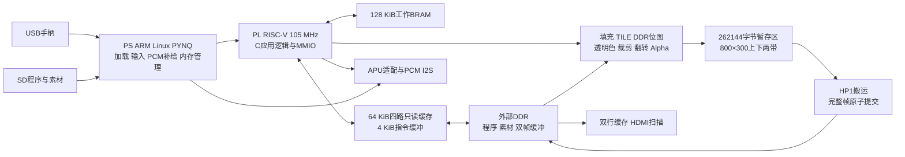

# 基于自研 RISC-V 的二维图形加速与实时交互 SoC

## 作品概述

本作品在 ALINX AX7020 的 XC7Z020CLG400-2 上实现可加载 C 程序的二维交互系统。PL 内的自研 RISC-V 处理器执行应用逻辑，专用图形数据通路完成批量绘制，DDR 保存程序、素材和显示双缓冲，PS ARM 负责 Linux/PYNQ 启动、USB 输入、音频补给及物理内存生命周期。作品将 CPU、图形基准与两类交互应用放在同一菜单和运行时中，使性能、正确性与实际使用路径可以互相核对。

实际应用画布为原生 800×600 RGB332，位于 1024×600 HDMI 输出中央，水平偏移112像素，未将640画布整帧放大。CPU 与图形时钟为105 MHz；525 MHz为视频串行时钟，不是CPU频率。采用 Vivado 2025.2.1；RV32编译器为既有2024.2工具目录中的GCC 13.3，两者分别记录。

核心成果是可编程处理器、分带图形/显示协同及可检验的运行时。游戏承担实际工作负载与交互演示；题材、第三方游戏规则、美术、音乐、字体和基准算法不计为全部自主原创。未测物理功耗，未宣称通用桌面、商业游戏完全兼容或优于其他开源CPU。

## 背景与已有工作

逐像素绘图会占用小型软核的指令和总线预算；程序、只读素材与显示扫描共享外部存储时，还会出现取指等待和帧提交延迟。简单增加频率或片上帧存，容易把问题转为时序或BRAM容量不足。因此本作品围绕“处理器负责逻辑，硬件负责成批像素操作，明确划分数据所有权”组织系统。

PicoRV32提供面积导向的RISC-V处理器参考，Project F展示FPGA显示、精灵和帧缓冲实践。二维硬件绘图本身不是新概念。本作品的区别在于把自研流水CPU、DDR程序/素材、两带提交、同场景软硬件绘制、音频和可恢复运行时合成可运行平台，并提供对应版本的字节身份、CRC、像素和逐扫描证据。没有在相同器件与工具参数下移植PicoRV32或Project F对照，因此不做跨项目性能优劣结论。

## 架构与软硬件分工

PS不代替软核运行游戏逻辑，Linux也不运行在自研CPU上。CPU发起MMIO图形命令；硬件执行矩形、图块、DDR位图和五档Alpha混合。软件比较模式由CPU写像素，仍按硬件接口要求初始化暂存带，该初始化成本计入时间；不能描述为完全不使用硬件的图形通路。

程序/只读内容链接到`0x80000000`，窗口16MiB；工作RAM位于`0x20000000`，容量128 KiB。应用状态、图形、音频MMIO分别从`0x10000100`、`0x10000200`、`0x10000300`开始。PS控制窗口为`0x43c00000`。这些地址仅适用于本作品，通用Skill不复制其常量。

## 自研处理器与存储设计

冻结实例实际使用`rv32i_pipeline_core`，具有注册IF、译码队列、EX、MEM、WB五个主级，允许不同指令处于不同阶段。两项译码队列为未完成取指保留空间；共享取指/数据服务明确串行仲裁，被重定向的取指响应先排空再复用，防止旧响应落到新路径。

最终`graphics_soc`实例启用动态分支预测、间接目标缓存、静态预测信息、预译码、结果旁路、本地load重叠、重定向响应交接及相关方向信息。`CPU_DUAL_ALU`取冻结模块默认值1，驱动`ALIGNED_DUAL_ALU`；可把满足条件的对齐相邻指令组成一对，第二槽限独立ALU，两项结果服从较老指令的提交/异常顺序。这是受约束的双指令路径，不是任意两条指令双发射，也不是乱序处理器。

指令集包含RV32I及Zmmul乘法；没有将硬件乘法称为完整M扩展除法支持。CoreMark构建使用`rv32i_zmmul`、`-O3`与LTO；部分图形/菜单目标继续使用各自冻结的RV32I配方。分目标保存配方，避免把一个全局ISA标记套在所有程序上。

64 KiB四路只读DDR缓存使用64字节缓存行，配合4 KiB指令缓冲。整条指令行在AXI成功结束后发布；错误、flush及hold阻止不完整行被当作有效指令。工作RAM与栈单独位于BRAM，系统没有可写通用数据缓存或虚拟内存，不能按通用Linux计算机描述。

## 图形与运行时设计

原生800采用一个262144字节暂存区，每带800×300、240000字节。上带完成后搬到DDR后台帧缓冲区，再绘制/搬运下带，只有完整两带到齐才发布整帧。该结构用有限片上存储容纳更大画布，避免扫描到半帧新内容。显示端从DDR读取，双行缓存隔离短时总线波动。

该图由冻结的native_frame_commit模块在XSim中产生，预先提交一帧后记录下一帧；上带完成不会更换front，下带完成后仍等待frame_edge。测试平台使用10ns时钟并指定复制忙等待周期，在时钟边沿后1ns采样；这是控制协议的功能示例，不用于推算板端DMA耗时或105 MHz系统帧率。CSV、测试平台、工具日志和SHA随包保存。

RGB332每像素8位，透明色与五档Alpha独立定义。Alpha为0%、25%、50%、75%、100%，不是8位Alpha。裁剪、翻转和混合按照实际命令顺序产生画面；CPU与硬件结果使用独立标量像素合成器核对。

日常菜单、鸡蛋兄弟和星际弹幕共用持久PS owner与显示缓冲。六卡主菜单触屏单击选中、双击进入，鼠标左键进入、右键返回；触屏底部SELECT提示区与手柄SELECT返回应用中心。虚拟方向/OK条已移除。直接手势板端回放覆盖24项检查、25次安全切换、32份CRC及30份PCM CRC；输入优先级为手柄、触屏、鼠标，自动回放与人工体验分开记录。

P008持续轮询服务保留。对旧05e3:0608 hub、有线手柄、G102和P008的精确组合，兼容服务停用鼠标附加键盘接口；手柄重连时短暂释放鼠标主接口，确认有效手柄输入后恢复鼠标。用户已确认普通及约1秒重插后三输入自动恢复。此前ENOSPC、超时及无效间隔试验保留，未声称修改内核根因；冷启动、长期休眠与其他组合仍待验收。

退出先让当前生产者完成正常final协议，或使用已验证的fatal取消并确认排空，再HOLD、等待实际DMA/扫描退场、释放程序与显示内存。不能在未完成的native帧上先HOLD，因为停止的生产者可能正是补完下一带所需的参与方；未知排空时保留owner和buffer，不强杀或叠加加载。RTR1短退出包保留应用、音量/静音、目标和故障摘要，并保留交替位、FNV与退场屏障；它仅证明退休，不当作完整性能样本。

星际新版采用AI生成怪兽、Kenney CC0战机和重新绘制的RGB332界面；保持360×420战斗区域，右上角提示留出边距。侧栏去掉两组测量显示，底层测量保留；LT/RT选择三档弹幕。对应版本每档不少于60秒实测约60.00/51.98/31.84 FPS，默认档每次扫描均有新帧。鸡蛋展示模式也由LT/RT选三波，同波内部保留原10秒循环，不自动换到下一波；多个约8秒有效计量窗口独立记录。默认音量5，仅星际战斗音乐跳过开头5秒，循环点同步平移；其他音乐保持。

## 实测指标与验证口径

硬件基准身份：`top.bit` SHA256为`cd467ddc352f4aaa93068ea0d1cfc78c75fe1b9de93ef915bfb10048a0f5fe9e`。本报告性能以该已上板硬件及对应程序为准；冷重建产物另存，不自动换成新bit后沿用旧成绩。

| 项目 | 结果 | 范围 |
| --- | --- | --- |
| CoreMark性能配置 | 4000次，1129481426ticks，10.75696596s，371.852064分，3.541448/MHz | 105 MHz，GCC 13.3，O3/LTO，单核2K，RV32I_Zmmul |
| CoreMark验证配置 | 4000次，1132545383ticks，10.78614650s | 与性能轮各核对5个CRC，验证配置不替代性能配置成绩 |
| TILE默认512对象 | 60.45000005s，3627新帧=3627扫描 | 相同bin/bit可继承的逐扫描严格60窗口 |
| DDR位图默认96对象 | 60.41666868s，3625新帧=3625扫描 | 相同bin/bit可继承的逐扫描严格60窗口 |
| Alpha默认32对象 | 60.41666652s，3625新帧=3625扫描 | 采用showcase_final_g对应当前alpha.bin，不能误用旧status_y的alpha |
| 鸡蛋兄弟64/85/100对象 | 约60.00/41.83/29.75FPS | 手动保留各波至少35秒；同波10秒循环，取各波已采集的约8秒计量均值，排除120逻辑tick预热；不是连续60秒 |
| 新UI星际默认1 | 61.93333331s，3716新帧=扫描，missed/nonunit/漏逻辑tick均0 | 本轮新程序和PS密度范围检查已实测，CRC/PCM与安全退场重核通过 |

新版星际密度1/2/9各测不少于60秒，完成帧率约60.00/51.98/31.84 FPS，默认档3716新帧等于3716扫描，非单位间隔、漏扫描和漏逻辑tick均0。高档是真实负载掉帧。原慢软件绘制30.22秒完整包的历史证据保留；运行时继续要求20秒内有符号进展、120秒内完成整包，并校验CRC、故障与退休状态。

精确CoreMark由`ticks / 105000000`得到秒数，再用`4000 / seconds`计算。原ASCII控制台整数打印10秒和400次/秒是截断显示，不作为精确成绩。显示扫描60Hz也不等于应用60FPS；严格60资格要求连续不少于60秒、新帧与扫描数相同、非单位间隔/漏扫描/漏逻辑tick均为0。

图形基准的真实板端参考分别检查479936像素，末尾64字节遥测单独解析；CPU页面检查473600显示像素，6400诊断字节按日志/CRC验证。星际UI当前本机检查20组，每组480000像素，对比同一高层C渲染器的独立标量合成与实际两带HW/SW发命令路径，并断言逻辑状态不变。它证明像素合成，不替代实物观感和板端带宽测量。

## 资源与优化取舍

| 范围 | LUT | FF | BRAM36 | DSP |
| --- | ---: | ---: | ---: | ---: |
| 完整PL系统 | 23447 | 11576 | 126 | 4 |
| CPU核心u_cpu层级 | 6387 | 2081 | 0 | 4 |

CPU的6387 Total LUT包含5998逻辑LUT和389 LUTRAM；外部DDR缓存、工作RAM及图形模块不计入该核心层级。完整系统占用约44.07% LUT和90% BRAM。实现后WNS +0.033ns、WHS +0.057ns、WPWS +0.312ns，不能据此承诺任意提频；未测功耗与能效。

| 优化事项 | 原问题 | 采用结果与代价 |
| --- | --- | --- |
| CPU与存储协同 | 多周期执行、共享缓存取指等待、本地load和分支交接开销 | 发展为五主级流水与受约束双指令路径，配合预测、旁路和缓存行发布；最终成绩与完整源码绑定，未把多项同时变化说成单因素收益 |
| 原生800分带 | 完整800×600帧需要480000字节，整帧BRAM结构受容量限制 | 800×300两带复用262144字节暂存，完整帧原子提交；代价为两次搬运/绘制协调 |
| 短退出确认 | 日常退出传输80字完整遥测并额外等待52帧按键尾音 | 12至13符号RTR1短包，取消尾音等待；18次板测回菜单约0.35至0.37s、进鸡蛋约0.50至0.58s、星际内部约0.39至0.42s |
| 展示负载分档 | 重负载逐扫描60不成立 | 用实测确定默认与失败邻档；鸡蛋保留短场景约60/42/30FPS曲线，不提高显示刷新数冒充渲染帧数 |
| UI与可解释数据 | 图像放大模糊、散乱文字、无功能意义的零分数和血条 | 同一画布内重排，不改玩法、碰撞和绘图区；重做编译、像素和受影响板测 |

切换时间从PS收到退出请求量到下一应用ready，不是物理按键端到端精密延迟。CPU历史61.85分与最终371.85分之间同时改变了微架构、50.25至105 MHz频率、编译选项和存储路径，因此不能把其比值称为某一个优化的加速比。对外量化比较优先使用同版本同场景的CPU/HW数据。

## 失败记录与AI协作

模型参与源码分析、RTL/C/Python实现、实验脚本、报告和证据核对。人负责需求、接线、实物观察、设计取舍及最终提交。真实可见提示词/回答节选与事后分析分别存放；不导出隐藏推理，不补造历史对话，不把AI生成实现全部写成参赛者独立手写。

保留的关键失败包括native帧未结束时HOLD的AXI依赖死锁、BEGIN前上传资源触发门拒绝、pending期间STATE写被忽略、USB集线器枚举超时、软件打包器把编译器版本查询当编译步骤，以及低帧率软件绘制触发整包遥测超时。每项均保留原始失败、变更范围和新验证，不用恢复成功覆盖功能失败。

通用Skill由这些观察提炼出“绑定版本、独立黄金参考、分清字节校验和语义证明、按真实总线依赖退休”的工作流。标准库校验器在正常、坏哈希、坏字节、空范围、越界、路径逃逸、空清单与合法局部比较8项中验证行为，另核对当前发布真实文件。没有声称已完成不同板卡的现场验证。

## 复现与提交边界

八个RV32目标采用四组冻结源：五个CPU/图形目标使用stable源；鸡蛋使用已资格镜头版interactive源；星际使用本轮冻结的space源；本轮主菜单使用独立menu源，避免改公共渲染器而影响其他程序。每个目标保留实际命令、依赖和期望SHA256。当前八目标已在含空格的新目录逐字节重建一致，GCC依赖输出确认包含文件均来自包内；此结论限同一开发机工具链，不是全新电脑验证。

硬件包包含完整RTL、XDC、显式IP/BD、初始化数据和原构建/验收脚本。冷重建已从82项封装输入完成工程/BD/IP重建、综合、布局布线、原验收门以及bit/XSA/HWH导出，不使用旧XPR、DCP或生成缓存。重建资源仍为23447 LUT、11576 FF、126 BRAM36、4 DSP，WNS/WHS/WPWS仍为+0.033/+0.057/+0.312ns。新bit/HWH的文件SHA分别以9783db22和88437ec5开头；它们未上板，运行包继续使用原已实测bit/HWH。独立运行包面向已经具备合适AX7020 PYNQ环境的板卡，不等同于附带可任意烧录的新SD镜像。程序、音乐和生成素材数组均纳入来源清单，不能只检查图片文件名。

当前持久版为native800_final_visual_a，两款应用视觉/手动展示、直接菜单、音频和USB兼容已整合。代码、依赖、截图和自动收据随包冻结；实物正面、45度整体和接线三张照片留待补充，运行页由真实板端截图覆盖。听感、物理断电启动、长期休眠和最终提交仍单列。目录未压缩或公开上传，视频暂不制作。

## 参考来源

- AMD自主选题完整指南第3.3节：<https://gitee.com/Vickyiii/fpgachina26-amd/blob/master/TRACK_GUIDE_2026.md>，2026-11-02已重新下载原文并保存SHA256。
- RISC-V基础规范及本工程冻结实现；ISA不计为原创。
- CoreMark：<https://github.com/eembc/coremark>，固定提交`1f483d5b8316753a742cbf5590caf5bd0a4e4777`。
- PicoRV32：<https://github.com/YosysHQ/picorv32>；Project F：<https://github.com/projf/projf-explore>，仅作已有工作定位，无跨平台优越性结论。
- PYNQ：<https://github.com/Xilinx/PYNQ>；fpganes APU：<https://github.com/strigeus/fpganes>。具体许可与修改说明见licenses目录。
- Kenney Space Shooter Remastered：<https://kenney.nl/assets/space-shooter-remastered>，官方标为CC0。字体、音乐、游戏脚本分别记录，不因视觉换名而重新授权。
- Linux v6.6 USB/HID与EHCI源码：<https://github.com/torvalds/linux/blob/v6.6/drivers/hid/usbhid/hid-core.c>、<https://github.com/torvalds/linux/blob/v6.6/drivers/usb/host/Kconfig>。作为排查参考；未取得与板端提交完全一致的完整内核源码，不将上游参考当成已发布的本板修复。
