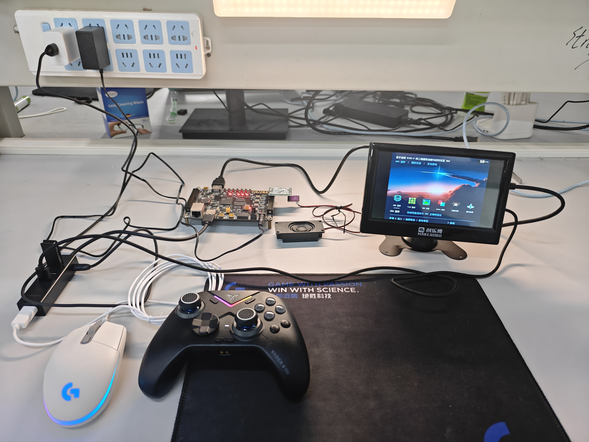
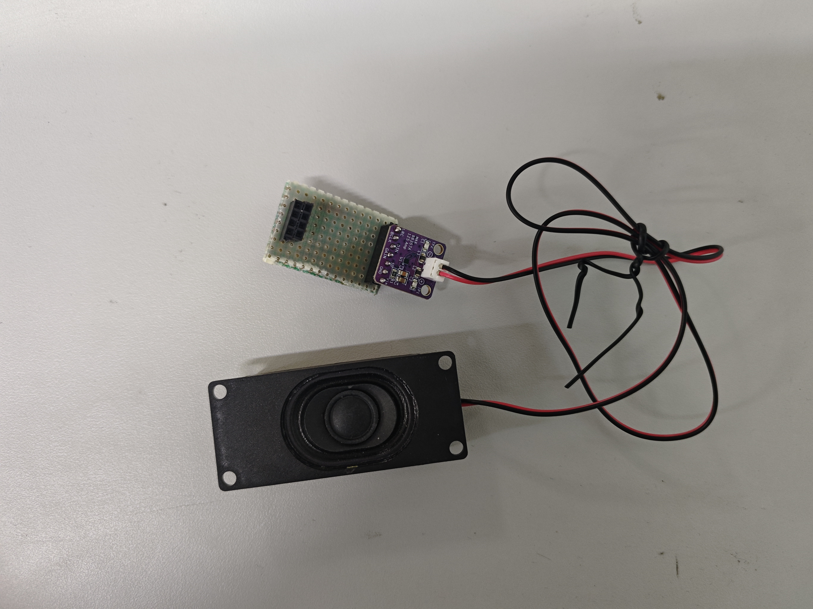

# 自研RISC-V二维图形SoC

## 选题背景与创新点

### 应用背景与设计目标

本作品面向 FPGA 软硬件协同教学与二维交互应用，在 ALINX AX7020 的 Zynq XC7Z020CLG400-2 上构建可加载 C 程序的图形系统。系统将处理器计算、批量像素绘制、显示扫描、输入和音频整合，通过 CPU 基准、固定图形负载及两款交互应用验证设计效果。

小型软核逐像素绘制会占用较多指令和总线周期，而完整 800×600 RGB332 画面需要 480000 字节，超过单个片上暂存区容量。本设计分别从处理器执行效率和图形存储组织入手，将控制判断交给软核，将重复像素操作交给专用硬件，并通过两带复用在有限 BRAM 中生成完整画面。

### 已有工作与自主贡献

本作品以开放指令集和 FPGA 图形技术为基础，参考 PicoRV32、Project F 等公开项目的设计思路，自主实现流水处理器微架构、图形命令与分带提交通路，以及可加载应用、外设和资源管理系统，形成计算、绘制、显示与交互协同运行的完整作品。

核心创新集中于三方面：预测、旁路及条件双指令路径协同提升软核执行效率；以 256 KiB 暂存区复用实现原生 800×600 图形生成；通过整帧提交、独立像素参考和逐扫描计数将图形正确性与持续性能统一验证。这些设计共同体现资源受限 FPGA 上的系统级协同优化。

作品明确区分自主系统设计与第三方应用资源：处理器、图形与运行管理为技术主体，标准基准与交互场景用于形成可复现的综合负载；字体、音乐和美术保留来源清单，便于复现和后续扩展。

## 设计原理与功能框图

### 系统总体结构

PS ARM 运行 Linux/PYNQ，承担程序加载、USB 事件采集、PCM 数据补给和物理内存管理；PL 自研 RISC-V 执行裸机 C 应用，图形模块完成批量像素处理。DDR 保存程序、素材和显示双帧缓冲，HDMI 从已提交的前台帧读取数据。

实际应用画布为 800×600 RGB332，居中于 1024×600 HDMI 扫描区域，左右各留 112 像素。CPU 与图形工作频率为 105 MHz，视频串行时钟为 525 MHz。两者承担不同任务，性能统计使用 CPU 实际时钟。

### 处理器与存储结构

处理器采用注册取指、译码队列、执行、访存和写回五个主流水级，结合动态分支预测、间接目标缓存、预译码与结果旁路，减少控制转移和数据相关带来的等待。共享取指与数据通路采用明确仲裁，被重定向的旧取指响应先排空，再复用请求状态。

处理器对满足对齐、数据独立性和操作类型条件的相邻指令启用第二 ALU 槽，两项结果依照程序顺序提交并处理异常。条件双指令执行与预测、旁路共同减少指令等待，指令集采用 RV32I 与 Zmmul 乘法扩展。

DDR 程序和只读素材通过 64 KiB 四路缓存访问，缓存行大小为 64 字节；4 KiB 指令缓冲改善取指局部性，128 KiB BRAM 保存工作数据与栈。只有 AXI 传输成功结束后，缓存行才被发布为有效；错误、刷新和暂停状态下阻止不完整行进入执行路径。工作数据与栈使用独立片上 RAM 路径。

### 图形加速与完整帧提交

CPU 通过内存映射寄存器提交矩形填充、TILE、DDR 位图、裁剪、翻转、透明色和 Alpha 命令。Alpha 支持 0%、25%、50%、75%、100% 五档。软件比较模式由 CPU 执行像素运算，其接口要求的暂存区初始化成本同样计入测试。

单带为 800×300、240000 字节，可放入 262144 字节暂存区。系统先绘制上带并搬入 DDR 后台帧，再复用同一暂存区绘制和搬运下带。控制模块仅在两带全部完成且到达显示帧边界时交换前后台，避免扫描到尚未完成的半帧；双行缓存用于缓冲显示侧短时总线波动。

功能仿真验证了上带搬运、下带搬运和显示帧边界切换之间的完整时序，整帧提交将绘制进度与前台扫描明确衔接。双行缓存进一步缓冲 DDR 访问波动，支持连续显示。

## 核心算法与硬件实现

本章按指令执行、存储服务、像素处理和帧提交四条路径，说明核心算法的输入、状态、更新规则与异常处理。设计中的预测和预取用于提前准备数据，结果能否进入执行或显示仍由完成条件及一致性检查决定。

### 分支预测与控制流恢复

控制流优化需要同时回答两个问题：下一条应从哪里取指，以及这个预测属于哪一条指令。当前实现组合了带标签的分支目标与方向记录、全局历史相关方向表、选择计数器和 JALR 目标缓存，并将预测元数据随指令通过流水级传递。

条件分支的基础记录为 64 项，以 PC[7:2] 索引、PC[31:8] 作标签，保存目标地址和 2 位方向计数器。相关方向表为 256 项，索引由 PC 的 8 位片段与最近已解析分支的 8 位历史异或得到：

$$
i_{\mathrm{corr}}=\mathrm{PC}[9{:}2]\oplus H,\qquad H_{\mathrm{next}}=((H\ll1)\mathbin{\vert}t)\bmod256.
$$

其中 t 为实际跳转结果，取 0 或 1。已有表项的计数器 C 按饱和加减更新，最高位决定方向；无效表项首次训练时根据实际结果初始化为弱不跳转状态 1 或弱跳转状态 2。

$$
C_{\mathrm{next}}=\begin{cases}\min(C+1,3),&t=1,\\\max(C-1,0),&t=0.\end{cases}
$$

| 计数状态 | 方向判断 | 状态含义 |
| --- | --- | --- |
| 0 / 1 | 不跳转 | 连续同向结果增强判断，反向结果使状态向另一方向移动 |
| 2 / 3 | 跳转 | 使用饱和更新，避免一次相反结果立即翻转强方向状态 |

选择器为每个分支索引保存 2 位偏好。当基础方向与相关方向不一致，并且该指令取指时命中了带标签的目标记录，解析结果才用于训练选择器：相关方向正确则增加偏好，否则减少偏好；两种方向一致时无需改变选择器。未命中的情况由既有预译码预测路径接续。JALR 使用独立的 32 项带标签目标缓存，解析后再由实际目标校正。

预测索引、两种候选方向及目标命中状态在取指时保存，并随 IF、ID、EX、MEM 中的同一条指令前进。训练使用这份保存的索引，不能在分支解析时用已经变化的全局历史重新计算；否则更新的可能是另一表项。相关方向表与全局历史只在分支解析且没有相应异常时更新。

控制流恢复还涉及在途取指。发生重定向时，已经发出的旧请求保留请求归属，通过 fetch_killed 标记阻止旧响应进入新路径，并完成响应接收后再交接端口。预测提高的是正确路径被提前准备的机会，最终执行与提交仍由实际分支结果、异常和握手条件决定。方向表的有效状态利用已有 32 周期初始化窗口清理，避免把统计 RAM 的旧值误当作有效预测。

### 数据旁路与受约束双指令

旁路网络按生产者与消费者的相对顺序选择操作数。对于非零源寄存器，优先检查 EX 中已完成的结果，其次是 MEM 中已完成的结果，最后是 WB 写回结果；没有匹配时使用寄存器文件的读值。这样可以在相邻指令组连续写同一寄存器时选到最新结果。

$$
v(r)=\begin{cases}0,&r=0,\\v_{\mathrm{EX}},&\mathrm{EX\ ready\ and\ match},\\v_{\mathrm{MEM}},&\mathrm{MEM\ ready\ and\ match},\\v_{\mathrm{WB}},&\mathrm{WB\ ready\ and\ match},\\v_{\mathrm{RF}},&\mathrm{otherwise}.\end{cases}
$$

实现同时检查两条配对指令的源操作数和两路目的寄存器，旁路有效性与结果完成条件绑定。Load 在数据返回前不能把地址计算结果当作加载值；一般 Load-use 依赖保留停顿，局部提前读路径则需要单独的握手条件。双指令组内的配对资格、组间的数据旁路和流水停顿分别处理，避免把“可配对”等同于“本周期一定可发射”。

双指令路径采用有条件的相邻配对。设两条指令依次为 I0、I1，第一条的有效目的寄存器为 rd0，第二条实际读取的源寄存器集合为 R1。配对首先要求第二条指令有效、取指无访问错误、PC 按 4 字节对齐，且 PC 不处于 64 字节缓存行的最后一个指令位置，保证相邻指令来自当前可用的数据范围。

$$
\mathrm{pair\_ok}=V\land A\land L\land T\land\neg\mathrm{RAW}\land\neg\mathrm{WAW}
$$

式中 V 表示指令对有效且访问正常，A 表示对齐，L 表示不跨当前缓存行，T 表示操作类型满足条件。当前配置中，第一槽允许合法 ALU 指令及启用扩展配对的 Load、Store、乘法指令，第二槽限定为译码器支持的普通 ALU 指令。后一条读取前一条结果时构成 RAW 依赖；两条写入同一个非零目的寄存器时构成 WAW 冲突，均拒绝配对。Store 没有目的寄存器，其指令位段不能误作 rd；x0 也不构成写入依赖。

例如 ADD x5,x1,x2 与 XOR x6,x3,x4 在上述取指和资源条件满足时可配对；若第二条改为 XOR x6,x5,x4，则因读取第一条的结果而分开执行。配对判定之后，寄存器端口可用性、流水级握手及异常控制仍会约束实际推进。该方法在局部独立运算中利用第二 ALU，同时保持明确的顺序提交关系，结果以整体基准测试评价，不假设任意指令流均达到每周期两条。

### 四路缓存与顺序访问服务

缓存容量为 65536 字节，行长 64 字节、相联度为 4，因此共有 1024 行、256 组。缓存模块以程序缓冲区内的字节偏移 A 为输入，将地址拆为行内偏移、组索引和标签：

$$
\begin{aligned}\mathrm{offset}&=A\bmod64,\\\mathrm{index}&=\lfloor A/64\rfloor\bmod256,\\\mathrm{tag}&=\lfloor A/16384\rfloor.\end{aligned}
$$

对应位段为 A[5:0]、A[13:6] 和 A[31:14]。四路标签并行比较，由有效位与标签共同决定命中；同组的不同标签可同时驻留，缓解指令和素材交替访问时的冲突。未命中时优先使用无效路，组满时按替换指针选路，并在成功完成该次填充后轮转指针。

每行由 16 个 32 位 AXI 数据拍填充。状态机只有在预期末拍收到 RLAST、所有响应正常且没有刷新请求时，才写入标签并发布有效位；提前结束、缺少末拍或错误响应均不能形成有效缓存行。容量优化与完整性控制结合，保证取指缓冲或请求交接不会消费半条缓存行。对应逻辑位于 ddr_read_cache.v。

一次未命中请求按 LOOKUP、ISSUE、FILL、RESPONSE 的顺序服务。请求的地址与 DDR 基地址先锁存，后续返回数据由该事务拥有，不能由变化中的外部地址重新解释。刷新先清有效状态；已经发出的 AXI 请求仍需完成接收。缺少预期 RLAST 时进入 DRAIN，丢弃多余响应，避免越界写入填充存储。

命中行还可以向指令缓冲顺序提供后续字。扫描地址和路号保持寄存，跨行时重新检查下一行的标签与有效位；新普通请求、交接或刷新会取消该扫描结果的可见性。内部提前读只准备数据，只有控制条件确认后才能对外发布，因而不能把推测读出的 RAM 数据直接当作有效指令。

| 条件 | 数据处理 | 对外发布规则 |
| --- | --- | --- |
| 完整 16 拍且响应正常 | 写入被选中的缓存路 | 末拍、标签与有效位一起提交 |
| 刷新或传输错误 | 保留在途事务的接收与排空 | 不发布新有效行 |
| 下一行已命中 | 允许顺序扫描跨行 | 重新绑定下一行地址、标签和路号 |
| 普通请求抢占扫描 | 转交正常请求的数据通路 | 旧扫描数据不再标记为有效 |

### DDR 位图突发读取与双区预取

DDR 位图输入由素材区域、源偏移 O、行步长 S、宽度 W、高度 H 和目标位置组成。模块在绘制前遍历全部源行，检查每行末端 O+rS+W 不超过素材区域长度，且要求 W、H 非零、S≥W、基址与区域大小满足字对齐。源区域范围使用扩展位宽检查，避免加法回绕后把越界地址误判为合法。

$$
\forall r\in[0,H-1],\qquad O+rS+W\leq B_{\mathrm{asset}}.
$$

前置检查把整条绘制命令的地址合法性与逐像素写入分开：后续行越界的命令在开始绘制前拒绝，避免先修改部分画面后才发现配置错误。

读取按不超过 16 个 32 位数据拍的块进行，并在 4 KiB 地址边界处拆分。设当前源字节地址为 P，行内剩余字节数为 R，q=P mod 4 表示首字中的字节偏移，则本块有效字节数 n 和总线数据拍数 m 为：

$$
\begin{aligned}n&=\min\bigl(R,\ 64-q,\ 4096-(P\bmod4096)\bigr),\\m&=\left\lceil\frac{q+n}{4}\right\rceil,\\A_{\mathrm{AR}}&=4\lfloor P/4\rfloor,\qquad\mathrm{ARLEN}=m-1.\end{aligned}
$$

例如 P=0x0FFB、行内剩余 20 字节时，首字偏移为 3，到 4 KiB 边界仅剩 5 字节，因此先取 n=5、m=2，从 0x0FF8 发起两拍读取，仅使用 0x0FFB 至 0x0FFF 的五个字节。下一块从 0x1000 开始，处理余下 15 字节。块拆分同时满足字节起始偏移、突发长度和边界约束。

数据缓冲由两个 64 字节存储区组成：当前区输出像素时，下一块进入另一区；当前块耗尽后，只有预取状态为 READY 且数据正常才交换读区。预取未完成时进入 WAIT_NEXT，形成读取与消费之间的显式等待。该结构重叠总线读取和像素处理，但并不假定 DDR 总能在固定周期内返回。

源像素位置与目标位置分开计算。水平翻转使用 x+W−1−column，垂直翻转使用 y+H−1−row，未翻转则使用对应加法；远端原点在命令开始时计算一次，逐像素仅需加减。目标位置通过带符号比较裁剪，再执行透明色与 Alpha 分支。

每个数据拍检查 RRESP 和 RLAST 是否与预期长度一致。已经发布的 AR 请求在 enable 撤销后仍保持握手，收到的响应也要排空；错误的预取块不进入像素输出。控制器用 written、skipped、clipped 计数区分实际写入、透明跳过和裁剪，便于定位图像差异。

### RGB332 定点混合与边界处理

位图像素采用 RGB332 编码，红、绿分量分别为 3 位，蓝分量为 2 位。设某个量化颜色分量的源值为 s、目标值为 d，透明权重 k 取 0、1、2、3、4，对应源像素占比 k/4。中间三档按以下整数式计算：

$$
c=\left\lfloor\frac{k s+(4-k)d+2}{4}\right\rfloor,\qquad k\in\{1,2,3\}.
$$

分子加 2 实现四舍五入，除以 4 通过右移两位完成；系数 1、2、3 由直通、移位和加法构成。红、绿分量分别计算，蓝分量先补零扩展后使用相同运算，再取其有效位。运算直接定义在 RGB332 量化分量上，软件参考也采用同一取整规则。

以源像素 0xE9 的分量 (7,2,1) 和目标像素 0x3B 的分量 (1,6,3) 为例，50% 混合取 k=2，结果为 (4,4,2)，重新编码得到 0x92。这个例子同时检查分量拆分、舍入和重新拼接，能发现把整字节当作颜色标量混合的错误。

像素写入还受裁剪、透明色键和权重分支控制：越界或命中透明色键的像素不写入；k=0 保留目标；k=4 直接写源像素；k=1、2、3 读取已初始化的目标像素后混合。控制器对未初始化暂存区的中间权重命令进行拒绝，避免把未知背景值带入结果。位图混合逻辑位于 ddr_bitmap_blit.v，命令有效性检查位于 framebuffer_engine.v。

软件参考与硬件实现使用相同的量化域、取整常数和透明规则，比较的是完整像素结果。只检查对象数量或画面大致相似，无法发现低位舍入、透明色优先级或边缘裁剪的偏差。验证输入因此应覆盖混合档位、透明键命中、跨边界对象及不同背景值，并同时检查未初始化目标的拒绝路径。

### 两带合成与整帧发布

以 b=0、1 表示上下分带，每带高度为 300。场景坐标经过镜头或界面偏移得到屏幕坐标 (xs,ys)，再与当前分带及用户裁剪矩形求交。仅保留交集内的像素，局部纵坐标和暂存地址为：

$$
y_{\mathrm{local}}=y_s-300b,\qquad A_{\mathrm{stage}}=800y_{\mathrm{local}}+x_s.
$$

有效范围为 0≤xs<800、300b≤ys<300(b+1)。跨越上下带边界的对象分别绘制其交集部分，不需要在片上同时保留完整画布。每带 800×300=240000 字节，小于 262144 字节容量；两带共享同一暂存区，DDR 双帧缓冲承担完整后台图像与前台扫描。地址乘数 800 可分解为 512+256+32，RTL 用移位相加形成像素地址。

$$
\begin{aligned}\mathrm{present}={}&\mathrm{READY}\land\mathrm{frame\_edge}\land\neg\mathrm{copy\_busy}\\&\land\neg\mathrm{fault}\land\mathrm{enable}\land\neg\mathrm{abort}.\end{aligned}
$$

整帧控制依次经历上带接收及搬运、下带接收及搬运、READY 和帧边界发布。式中 fault 汇总传输错误和本帧失败标志，运行以复位已释放为前提。只有发布条件成立时才切换前台并增加完整帧计数；一个分带完成不能提前计作一帧。这样把暂存区复用与显示可见性分开控制，在节省片上容量的同时保持完整画面的一致提交。

| 状态 | 进入或完成条件 | 下一步 |
| --- | --- | --- |
| IDLE | 接受新帧且总线可用 | 锁定 DDR 后台缓冲，等待上带 |
| LOAD0 / WAIT0 | 上带编号正确，搬运完成且不忙 | 等待下带 |
| LOAD1 / WAIT1 | 下带编号正确，搬运完成且不忙 | 进入 READY |
| READY | 允许发布且到达 frame_edge | 切换前台，完整帧数加一 |
| DRAIN | 取消或故障后仍有在途操作 | 等待 copy 与 bus 全部排空，再回 IDLE |

后台缓冲选择在帧开始时锁定为当前前台的另一个缓冲，直到本帧发布前保持不变。错误分带编号、取消和传输故障会进入失败与排空路径，不能让部分完成的数据被下一帧继承为有效结果。

存储开销可以分为暂存与完整图像两部分：片上暂存复用 262144 字节，DDR 的两幅完整 RGB332 画面共需 2×800×600=960000 字节。减少的是片上完整画布需求，代价是两次分带绘制与搬运协调，以及到达帧边界前的等待。持续吞吐由实际绘制、搬运和显示共同决定，不能把容量节省直接换算为帧率提升。

### 正确性条件与验证对应

验证按机制的正确性条件组织，并把源码条件、仿真输入与板端结果对应起来。不同证据回答不同问题：源码能定位实现条件，正负例检查控制分支，板端周期与 CRC 检查实际负载下的系统输出。

| 机制 | 关键检查点 | 随包核对入口 |
| --- | --- | --- |
| 预测与配对 | 预测索引随所属指令保存；数据相关阻止错误配对 | rv32i_pipeline_core.v；CPU 两配置 CRC 与原始周期 |
| 缓存交接 | 标签与完整填充结果一致；刷新不发布半行 | ddr_read_cache.v；对应程序映像及复算记录 |
| 位图与混合 | 裁剪、透明色、舍入和末尾像素一致 | graphics_ideal / graphics_backpressure 的 480000 像素用例 |
| 初始化与异常输入 | 错误输入必须命中指定拒绝条件 | software_missing_init、audio_bad_sample |
| 音频与绘图并行 | 画面提交期间采样次序与 CRC 一致 | audio_concurrent；板端 PCM 数据 |
| 退出与排空 | 旧顺序能够复现问题；正确顺序检查在途 DMA | hold_retirement；退出及 cleanup 记录 |

CPU 的最终评价使用 105 MHz 下的 CoreMark 与资源报告；图形部分使用独立像素参考和连续扫描计数。各机制共同作用后的系统指标在性能章节集中列出，并与对应源码、程序身份和测量窗口关联。

## 软硬件划分依据与接口设计

### 分工依据

应用状态更新、菜单判断与负载选择包含较多条件分支，适合使用 C 程序由软核执行；填充、位图读取和透明混合具有重复像素运算特征，使用专用硬件降低指令开销。PS 利用现有 Linux USB 与文件系统支持管理外设和素材，应用逻辑及图形生成保持在 PL 侧。

| 功能 | 实现位置 | 主要输入与输出 |
| --- | --- | --- |
| 应用逻辑 | PL RISC-V | 统一输入状态 → 绘图及音频控制命令 |
| 像素运算 | PL 图形模块 | 参数与素材 → 暂存带像素 |
| 显示提交 | PL 搬运与扫描模块 | 完整两带 → DDR 前台帧与 HDMI |
| 外设与加载 | PS ARM | USB、文件 → 输入寄存器与程序内存 |
| 音频播放 | PS 补给、PL I²S | PCM 数据 → 数字音频串行输出 |

### 存储与控制接口

| 地址区域 | 功能 |
| --- | --- |
| 0x80000000，16 MiB 窗口 | 程序与只读素材 |
| 0x20000000，128 KiB | 工作 RAM 与栈 |
| 0x10000100 | 应用状态与控制 |
| 0x10000200 | 图形命令与状态 |
| 0x10000300 | 音频控制 |
| 0x43c00000 | PS 控制窗口 |

软件分别组织菜单、两个 CPU 配置、三类图形基准和两款交互应用。每个程序保留独立构建配方，防止公共代码调整后无法重现对应测试程序。

### 输入 音频与资源生命周期

手柄、触屏和鼠标事件由 PS 统一采集。触屏双击结合时间、位置和当前页面判定，鼠标采用按键边沿触发；应用切换时清理未完成手势。主菜单为六入口单排布局，手柄、触屏与鼠标均可完成进入和返回。

多外设管理结合设备识别、输入优先级和重连调度，协调手柄、触屏与鼠标接入统一控制接口。实物操作覆盖三种输入的应用进入、返回及手柄启动后的输入接续，体现完整的人机交互能力。

音频采用 32 kHz、单声道、有符号 16 位 PCM。PS 补给 FIFO，PL 完成播放与 I²S 输出，经 MAX98357A 音频放大器驱动扬声器。自制洞洞板使用双排母连接开发板接口与商购音频模块；配套扬声器标称规格为 3 W、8 Ω。

应用切换采用完整的退出握手：请求当前应用完成帧提交与退出确认，协调音频暂停及搬运排空，再暂停软核并释放内存。按生产者与消费者依赖组织交接，使程序、图像和音频资源具有一致的生命周期。

**退出协议的依赖顺序**

资源释放顺序由硬件依赖决定。若先 HOLD 停止软核，而停止响应又等待帧引擎空闲，未完成的帧还需要软核提交下一个分带，就会形成循环等待。因此正常路径先让应用完成最后一帧和退出确认；异常路径先执行专用取消并等待在途事务排空，之后才能停止软核和释放连续内存。

退出检查同时关注程序是否仍被访问、显示缓冲是否仍被扫描以及音频是否已暂停，避免只根据软件进程状态决定释放资源。测试台保留旧顺序的死锁复现，并分别检查无在途 DMA 和存在在途 DMA 时的安全取消路径，使接口顺序有对应的反例与正例支撑。

## 优化过程与性能资源对比

### 测试方法与主要结果

CoreMark 使用 GCC 13.3、RV32I_Zmmul、O3 与 LTO，单核 2K 数据配置，4000 次迭代。性能轮记录 1129481426 个时钟周期，在 105 MHz 下对应 10.75696596 秒，得分 371.852；验证轮独立核对 CRC。图形帧率统计区分显示扫描与真正完成的新帧，持续 60 FPS 条件要求不少于 60 秒窗口内逐扫描提供新画面。

| 测试项目 | 实测结果 | 测试条件 |
| --- | --- | --- |
| CoreMark | 371.852 分；3.541 分/MHz | 105 MHz，4000 次；两配置 CRC 通过 |
| CoreMark/LUT | 0.05822 分/LUT（CPU核心） | 371.852064 分 / 6387 LUT |
| TILE | 3627 新帧 / 3627 扫描 | 512 对象，60.4500 秒 |
| DDR 位图 | 3625 新帧 / 3625 扫描 | 96 对象，60.4167 秒 |
| Alpha | 3625 新帧 / 3625 扫描 | 32 对象，60.4167 秒 |
| 星际三挡 | 60.00 / 51.98 / 31.84 FPS | 密度 1 / 2 / 9；每挡不少于 60 秒 |
| 鸡蛋三波 | 60.00 / 41.83 / 29.75 FPS | 64 / 85 / 100 对象；多个约 8 秒窗口 |

鸡蛋展示模式循环所选波次的 10 秒场景，排除前 2 秒预热后统计有效窗口；星际各挡采用不少于 60 秒的连续统计。三挡场景分别展示不同对象密度下的计算与绘制吞吐，形成可操作、可观察、可对照的负载梯度。

**帧率与资源效率的计算口径**

设测试窗口的时钟周期增量为 ΔC，处理器时钟为 f，完整帧数与扫描数增量分别为 ΔF、ΔS。持续时间和帧率按原始计数计算：

$$
T=\frac{\Delta C}{f},\qquad\mathrm{FPS}=\frac{\Delta F}{T},\qquad R_{\mathrm{scan}}=\frac{\Delta F}{\Delta S}.
$$

Rscan 只表示窗口内的计数比值。严格持续 60 FPS 还要求窗口不少于 60 秒，扫描与完整帧同步增长，遗漏和非单位进度计数为零，并结合状态、CRC 与独立像素参考确认结果。仅凭窗口首尾帧数相等，不能排除窗口中重复显示后又集中提交的情况。以 TILE 记录为例，3627 帧对应 3627 次扫描，持续 60.4500 秒，相关异常计数同时通过检查。

$$
\mathrm{CoreMark}=\frac{4000\times105000000}{1129481426}\approx371.852.
$$

CoreMark/MHz 由得分除以 105 得到约 3.541；CoreMark/LUT 采用 CPU 层级的 6387 LUT，得到约 0.05822。图形软件/硬件对照的帧率比值反映整条应用与显示路径，硬件结果受约 60 Hz 显示节奏限制，不能直接解释为像素运算峰值吞吐倍数。不同场景的计量窗口和对象数量分别列出，便于复算及公平比较。

### 优化方案与实现效果

| 优化内容 | 优化前 | 采用方案及结果 |
| --- | --- | --- |
| 帧存组织 | 完整画布需 480000 字节 | 两带顺序复用 262144 字节暂存区，完成原生 800×600 绘制与整帧提交 |
| 程序加载 | 菜单出现前集中准备资源，软件重启约 40～43 秒 | 按需加载并缓存，软件重启两次分别 33.38 / 36.10 秒；首次应用进入约 2.7～4.6 秒，重复约 0.4～0.6 秒 |
| 音频补给 | Python 逐样本写 FIFO 增加解释器开销 | 同一管理进程调用 C 函数连续写入，PCM 校验确认对应输出数据一致 |
| 应用切换 | 多模块分别管理退出与资源 | 统一退出握手与搬运完成链，通过仿真和实机切换验证有序交接 |

按需加载与缓存复用将软件重启至菜单的时间由约 40～43 秒缩短至 33.38～36.10 秒，重复进入应用约需 0.4～0.6 秒。处理器执行、存储访问、图形绘制与运行管理的优化分别通过对应的周期、帧率、资源及启动数据评价，构成从微架构到交互体验的协同优化。

### 资源与时序

| 范围 | LUT | FF | BRAM36 | DSP |
| --- | ---: | ---: | ---: | ---: |
| 完整 PL 系统 | 23447 | 11576 | 126 | 4 |
| CPU 核心 | 6387 | 2081 | 0 | 4 |

CPU 核心包含 5998 个逻辑 LUT 与 389 个 LUTRAM，共 6387 LUT；外部缓存、工作 RAM、图形和显示模块按各自层级统计。CPU 资源效率为 371.852064 ÷ 6387 = 0.05822 CoreMark/LUT。完整 PL 为 23447 LUT，占器件 LUT 的约 44.07%。105 MHz 实现后 WNS +0.033 ns、WHS +0.057 ns、WPWS +0.312 ns，满足实现时序要求。

## 大模型协作记录与设计复盘

模型参与需求分析、源码检查、RTL/C/Python 实现、实验脚本及结果整理。参赛者负责设计目标、接线、实物操作、效果判断和方案取舍。协作按“分析实际输入—提出方案—实现—独立参考比对—板端验证”组织，生成结果必须经过验证后才能进入稳定工程。

协作材料按“原始交互节选—设计归纳—验证记录”组织。collaboration 目录保存带来源定位的提示词与回答，model_collaboration.md 汇总方法与结论。典型优化过程如下。

| 优化任务 | 设计判断与实现 | 验证方法 |
| --- | --- | --- |
| 多模块资源交接 | 根据生产者与消费者依赖统一退出顺序 | RTL 正负例、退出状态核验与板端切换 |
| 不同绘制吞吐下的遥测接收 | 联合管理持续进展与整包时间窗口 | 慢速封包回放、负例及真实板端记录 |
| 综合资源与测试结果关联 | 按顶层实例、二进制与原始报告绑定 | 文件哈希、原始计数与独立重算 |

协作实践提高了跨模块关系梳理、方案比较和重复验证脚本的编写效率。模型建议经过源码核对、仿真和板端测试形成工程实现，实物操作进一步验证输入、显示与音频的协同效果。

## 技能包提炼过程与验证

项目围绕可复现构建、独立结果核对和应用资源交接，提炼了产物身份与二进制范围校验、PYNQ 资源生命周期管理两类可复用方法。skill 目录提供 README、使用步骤和适用条件，便于其他工程直接采用。

产物校验工具仅依赖 Python 标准库，接收清单、文件路径及比较范围，先核对非空输入与边界，再比较实际字节。验证覆盖正常、坏哈希、坏字节、空范围、越界、路径逃逸、空清单和合法局部比较八类情况，并对工程公开快照执行身份核对。

生命周期方法按“停止请求—生产者完成—消费者排空—释放资源”分析依赖，将可复用控制顺序与作品专用地址和寄存器配置分离。迁移时依据目标硬件的缓存、DMA 与外设协议补充配置及对应测试，既保留通用方法，也便于适配不同工程。

## 复现说明

### 环境与工程组织

硬件工具为 Vivado 2025.2.1，目标 XC7Z020CLG400-2；RV32 编译器为 GCC 13.3。板端需具备匹配 AX7020 的 PYNQ/Linux 环境及对应显示、USB 与音频连接。工程中的 software、hardware、runtime、sim、verification、skill、report 分别保存应用源码、硬件输入、运行入口、仿真、原始测量、技能包和报告。

### 构建与校验步骤

1. 从提交工程根目录读取 README、运行环境与来源清单，使用新的输出目录，核对 manifest 所登记的输入文件。
2. 执行 `python software/rebuild.py --destination <new_dir> --compiler <gcc_path>`，生成八个 RV32 程序并核对预期二进制。
3. 执行 `python hardware/rebuild.py --destination <new_dir> --vivado <vivado_path>`，从 RTL、XDC、IP/BD 和初始化数据重建硬件，检查资源与时序报告。
4. 执行 `python sim/replay.py --destination <new_dir> --vivado-bin <vivado_bin>`，重放功能正负例；再运行 verification 中的重算脚本核对性能与像素记录。
5. 按 runtime/readme.md 配置板端环境，确认没有其他进程占用硬件后启动 `runtime/run.py --start`，检查菜单、应用、输入、音频与正常退出。

以上步骤的完整命令、依赖版本和输出位置见 reproduction.md。工程已完成八程序独立重建及二进制一致性核对，并提供硬件源码综合、布局布线、导出记录与对应板端实测数据。源代码、构建配方、运行载荷和验证结果通过文件清单关联，为作品复现与继续开发提供完整入口。

## 参考文献

[1] AMD. 全国大学生嵌入式芯片与系统设计竞赛 FPGA 赛道选题指南，2026，第 3.3 节.

[2] EEMBC. CoreMark. https://github.com/eembc/coremark.

[3] YosysHQ. PicoRV32. https://github.com/YosysHQ/picorv32.

[4] Project F. FPGA Graphics and Display Designs. https://github.com/projf/projf-explore.

[5] Xilinx. PYNQ. https://github.com/Xilinx/PYNQ.

[6] Digilent. Vivado Library RGB to DVI IP. https://github.com/Digilent/vivado-library.

[7] strigeus. fpganes. https://github.com/strigeus/fpganes.

[8] Kenney. Space Shooter Remastered. https://kenney.nl/assets/space-shooter-remastered.
