# 自研RISC-V二维图形SoC

## 摘要

本作品自主构建了集处理器计算、二维图形加速与多模态交互于一体的 FPGA 片上系统。系统以 AX7020 开发板的 Zynq XC7Z020 为载体，贯通自研 RISC-V 微架构、专用图形流水、DDR 显示通路与 PS 运行管理，形成从 C 程序执行到画面、声音和操作反馈的完整链路。软核承担应用状态与绘图调度，图形硬件批量处理像素，PS 统一管理程序、外设和音频资源，充分发挥可编程计算与专用硬件协同的优势。

系统以分带复用突破完整画布对单块暂存区的容量需求：通过一个 262144 字节暂存区依次绘制上下两带，在 DDR 后台汇合为原生 800×600 RGB332 画面，并以整帧提交与双缓冲衔接显示扫描。作品集成 CPU 测评、三类软硬件对照实验及两款交互应用，支持手柄、触屏和鼠标统一操作，将微架构设计、图形加速和实物交互集中于同一演示平台。

测试结果表明，软核在 105 MHz 下的 CoreMark 性能配置得分为 371.852，两个测试配置的 CRC 均通过核对；TILE、DDR 位图和 Alpha 默认负载具有连续不少于 60 秒的逐扫描新帧记录。星际弹幕三挡负载实测约为 60.00、51.98 和 31.84 FPS。完整 PL 系统使用 23447 LUT、11576 FF、126 BRAM36 和 4 DSP。系统实现了处理器、图形、显示、输入与音频的统一调度，并通过基准测试、像素比对与实物操作验证主要功能，为资源受限器件上的可编程图形系统提供了实现方案。

关键词：RISC-V；图形加速；分带帧缓冲；软硬件协同

## 第一部分 作品概述

### 1.1 功能与特性

本系统将处理器执行、图形绘制和实际交互整合在同一块 FPGA 开发板上。用户通过主菜单选择 CPU 测评、TILE 图块、DDR 位图、Alpha 混合、鸡蛋兄弟或星际弹幕。各应用由软核运行独立 C 程序，绘图命令经统一接口送入图形硬件；返回菜单时由 PS 管理程序完成应用退出和下一程序装载。系统不依赖 PC 实时计算游戏画面。

交互方式以手柄为主，同时提供触屏和鼠标入口。触屏单击卡片选中、双击进入，鼠标左键直接进入，第一层应用可通过鼠标右键或底部 SELECT 提示区返回。两款应用的展示模式使用 LT、RT 切换三档负载，直观呈现实时交互、密集对象及高强度图形处理场景。

### 1.2 应用领域

本系统主要面向 FPGA 软硬件协同教学、处理器实验和二维图形数据通路验证。通过同一场景下的软件绘制与硬件绘制，能够观察通用指令执行和专用像素处理的分工；通过独立程序加载及菜单切换，能够进一步理解程序存储、输入接口、音频和显示之间的配合关系。

对于处理器与图形模块的调试，单一基准程序难以覆盖实际系统中的连续运行情况。本作品将标准计算负载、固定图形负载和交互应用结合起来，使算术正确性、像素正确性与持续帧率可以分别验证。后续可在保持接口不变的条件下增加新的 C 应用，用于探索不同计算与绘制比例下的性能变化。

### 1.3 主要技术特点

处理器采用注册取指、译码队列、执行、访存和写回五个主流水级，并结合分支预测、结果旁路及受约束的相邻双指令执行路径，减少部分指令间等待。DDR 中的代码与只读素材通过 64 KiB 四路缓存和 4 KiB 指令缓冲访问，工作数据及栈放在独立的 128 KiB BRAM 中。

图形部分以矩形、TILE 和 DDR 位图为基础，支持裁剪、翻转、透明色及五档 Alpha 混合。原生 800×600 画布通过两带复用、完整帧提交与 DDR 显示双缓冲协同生成，兼顾片上存储利用率和完整画面输出。

PS 端使用常驻管理进程统一组织输入、音频与应用切换。应用退出时先等待程序完成退出确认与数据搬运，再释放对应内存。测试中既保存性能数字，也保存程序身份、图像、CRC 和退出记录，使测量结果能够追溯到实际运行版本。

### 1.4 主要性能指标

| 指标 | 结果 |
| --- | --- |
| 器件 | XC7Z020CLG400-2 |
| CPU 主频 | 105 MHz |
| CoreMark | 371.852 分；3.541 分/MHz |
| CoreMark/LUT | 0.05822 分/LUT（CPU核心） |
| 应用画布 | 800×600，RGB332 |
| 星际三挡 | 60.00／51.98／31.84 FPS |
| 鸡蛋三波 | 60.00／41.83／29.75 FPS |
| PL 资源 | 23447 LUT；11576 FF；126 BRAM36；4 DSP |

### 1.5 主要创新点

1. 软核与图形硬件协同，统一应用、绘图和交互接口。

2. 两带复用 256 KiB 暂存，生成 800×600 画面并完整提交。

3. 独立像素参考与逐扫描计数联合验证图形正确性和持续帧率。

### 1.6 设计流程

本系统采用自顶向下的模块化设计方法。首先确定处理器、图形、存储与外设的分工及接口；随后完成 RTL 设计、功能仿真与时序分析；在此基础上开发 C 应用和 PS 管理程序，建立独立参考模型；最后进行板端性能测试、交互验证与工程复现，依据实测结果完成系统优化。

## 第二部分 系统组成及功能说明

### 2.1 整体介绍

系统由 PS 管理端、PL 软核计算端、二维图形模块、DDR 存储与 HDMI 显示模块组成。图 1 给出主要数据流：PS 将程序和素材准备到连续物理内存，PL 软核读取并执行程序，图形模块根据绘图命令生成暂存带，搬运模块将其复制到 DDR 后台帧缓冲区，显示端读取已经提交的完整前台帧。

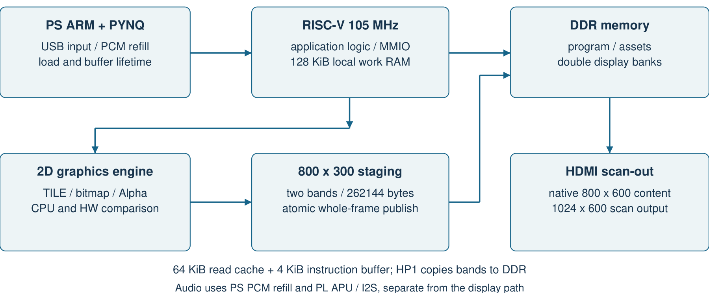

在该分工中，Linux/PYNQ 运行在 Zynq 的 PS ARM 上，承担外设与资源管理；自研 RISC-V 在 PL 内独立执行裸机 C 应用和游戏逻辑，图形硬件生成画面。PS 持续补给 PCM 音频，PL 音频模块完成播放与串行输出；统一输入接口将外设动作送入应用，构成计算、显示、声音和操作反馈闭环。

### 2.2 硬件系统介绍

#### 2.2.1 开发板与接口

硬件采用 AX7020 开发板及 HDMI 显示、USB 输入与 I²S 音频外设。HDMI 扫描尺寸为 1024×600，原生 800×600 应用画面水平居中，左右各保留 112 像素区域。处理器与图形逻辑运行于 105 MHz，视频串行时钟为 525 MHz，分别服务计算绘制和高速显示传输。

作品以成熟的 FPGA 开发板为硬件载体，自主实现 PL 计算与图形逻辑、RV32 应用以及 PS 协同管理软件。开发板经集线器接入三类输入设备，自制双排母洞洞板连接 I²S 功放与扬声器，形成紧凑、可演示的完整装置。系统实物与连接关系见第 3.2.4 节。

#### 2.2.2 处理器结构

软核采用五个主流水级，使不同指令可在取指、译码、执行、访存及写回阶段同时推进。取指端设置译码队列，在共享存储服务存在等待时保留必要的请求空间；执行端结合旁路与预测信息，降低部分数据依赖和控制转移造成的停顿。处理器主要结构如图 2 所示。

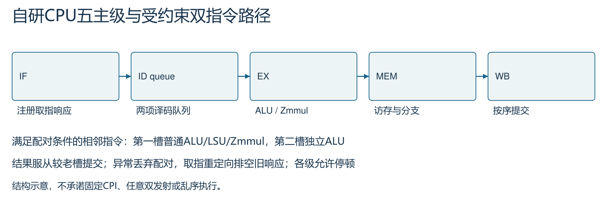

处理器为满足对齐、数据独立性和操作类型条件的相邻指令设置双指令执行路径，第二槽并行完成独立 ALU 运算，两项结果按程序顺序提交。该机制与预测、旁路共同提升有效执行效率。指令集采用 RV32I 与 Zmmul，乘法运算由专用单元完成。

#### 2.2.3 存储组织

程序与只读素材链接到 0x80000000 对应的 16 MiB 窗口，通过 64 KiB 四路只读缓存访问外部 DDR，缓存行为 64 字节。4 KiB 指令缓冲用于改善取指局部性；128 KiB 工作 RAM 位于 0x20000000，保存应用可写数据与栈。该结构使工作数据不必与大体积素材完全共享同一访问路径。

缓存控制围绕完整传输建立有效性管理：AXI 响应结束后发布缓存行，刷新、暂停和控制转移按协议完成请求排空。程序与只读素材采用缓存路径，工作数据使用独立片上 RAM，使访问特征不同的数据获得针对性的存储支持。

#### 2.2.4 二维图形与显示通路

CPU 通过内存映射寄存器提交绘图参数，专用模块完成矩形填充、图块绘制、DDR 位图搬运、透明色处理、裁剪和翻转。Alpha 混合提供 0%、25%、50%、75%、100% 五档。软件比较模式由 CPU 执行像素操作，同时保留接口要求的暂存区初始化，其开销计入测量。图 3 给出控制、绘制和显示之间的连接关系。

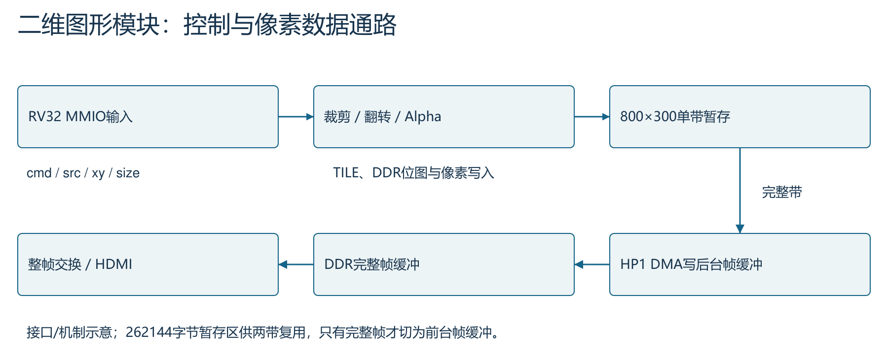

完整 800×600 RGB332 画面需要 480000 字节，超过本设计单个暂存区容量。我们将画面分为两个 800×300 的区域，每带占用 240000 字节。先绘制上带并搬运至 DDR 后台帧缓冲区，再复用暂存区绘制下带。仅当两带均完成且到达允许切换的帧边界时，控制模块才更新前台帧缓冲区。

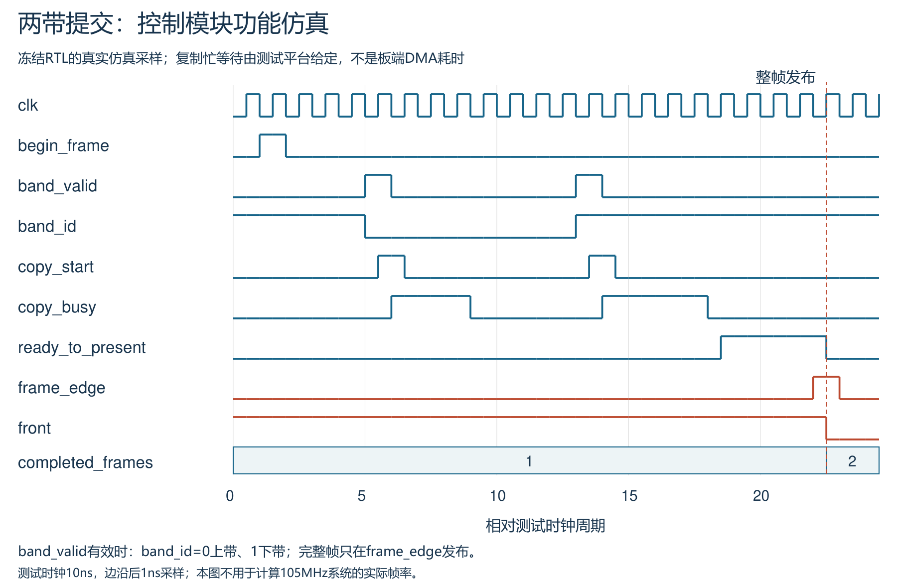

图 4 的功能仿真展示了“上带搬运—下带搬运—帧边界切换”的完整控制时序，验证单带完成与整帧发布之间的协调关系。显示侧配置双行缓存，吸收 DDR 访问波动并连续提供扫描数据。

#### 2.2.5 音频模块与接口转接板

外部音频采用 MAX98357A I²S 音频放大器模块与配套扬声器。FPGA 的数字音频信号通过自制洞洞板送入功放模块，完成从数字采样到扬声器输出的链路。转接板采用双排母插接和焊接走线，将开发板接口与音频模块固定连接；扬声器标称规格为 3 W、8 Ω。

### 2.3 软件系统介绍

#### 2.3.1 软件整体组成

软件分为 PS 管理程序、RV32 应用和 PC 侧构建验证工具三部分。PS 管理程序使用 Python/PYNQ 完成硬件加载、连续内存管理、USB 输入与 PCM 补给；RV32 应用负责菜单、计算测试、图形实验和游戏状态更新；PC 工具负责编译、参考模型计算、自动测试与结果整理。

八个 RV32 程序包括菜单、CoreMark 性能配置、CPU 验证配置、三类图形程序及两款交互应用。各程序分别保存实际源文件依赖、编译选项和预期二进制哈希，避免公共字库或渲染代码变化后无法重建某个已经测试的版本。

#### 2.3.2 输入与界面控制

PS 端读取手柄按键、摇杆和扳机，同时接收鼠标与触屏事件，再转换为应用使用的统一输入格式。触屏双击需要同一卡片及时间、位置约束；拖动、多点、页面切换与设备失联会取消未完成手势，防止上一页面的动作延续到下一页面。输入处理流程如图 5 所示。

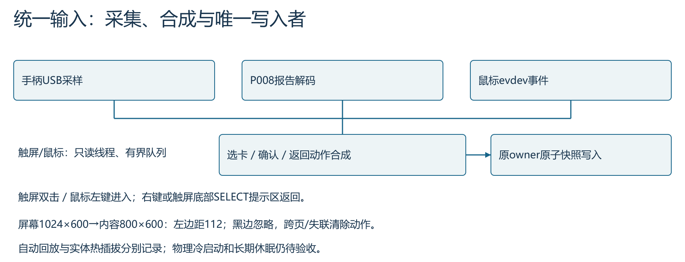

主菜单采用云海背景与底部六入口单排布局，通过图标、缩放和焦点动画形成清晰的导航层次。底部独立呈现应用说明及操作方式，手柄、触屏和鼠标共用一致的进入与返回逻辑。管理程序结合设备识别、输入优先级与重连调度，使多种操作方式衔接到统一应用接口。

#### 2.3.3 音频与应用切换

音乐以 32 kHz 单声道有符号 16 位 PCM 保存。PS 负责持续补给数据，PL 完成播放及串行音频输出，界面提示音按既有混音路径叠加。数字链路通过采样计数和 CRC 验证，扬声器输出通过现场播放演示。音乐及提示音分别保留来源记录。

应用切换采用有序资源交接：管理程序请求当前应用完成退出确认，协调画面提交、音频暂停和 DMA 排空，再暂停处理器并释放程序资源。该机制将程序、显示和外设的生命周期统一管理，为连续切换应用提供完整流程，见图 6。

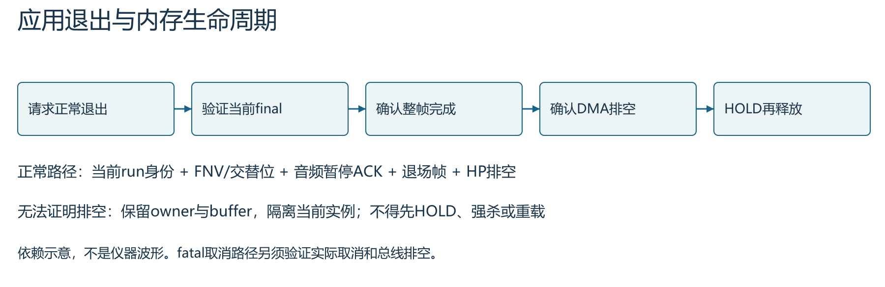

运行管理根据生产者与消费者依赖安排交接次序，使绘图任务、帧搬运和内存释放形成明确的完成链。日常切换使用轻量退出确认，性能测试保留完整采样和校验记录，兼顾交互响应与验证可追溯性。

## 第三部分 完成情况及性能参数

### 3.1 整体完成情况

本系统完成了从自研处理器、图形数据通路到显示与外设管理的软硬件集成，能够独立运行菜单、CPU 测评、三类图形实验及两款交互应用。系统以 AX7020 开发板为主体，配合 HDMI 触屏、USB 集线器、手柄、鼠标及 I²S 音频模块组成实物平台。

整机与接口实物、板端运行画面和性能测试结果分别用于展示系统组成、功能实现与量化指标。处理器计算正确性采用 CRC 核对，图形正确性采用独立像素参考比对，持续帧率通过新帧与扫描计数共同判定。下文依次说明各项工程成果及测试条件。

### 3.2 工程成果

#### 3.2.1 主菜单与 CPU 测评

系统主菜单如图 7 所示。底部单排六个入口将计算性能、固定图形负载与交互演示分开，进入应用后可通过统一返回方式回到菜单。触屏与鼠标的进入、返回逻辑完成了各六个入口的自动事件回放，实物测试覆盖手柄、触屏和鼠标的应用进入与返回。

CPU 测评提供性能和正确性结果。性能配置采用 4000 次迭代，累计 1129481426 个 105 MHz 时钟周期，对应 10.75696596 秒，计算结果为 371.852064 次每秒。另一配置用于核对正确性，两轮分别检查五项 CRC。图 8 显示板端结果页，精确成绩由原始周期数计算，控制台整数秒与整数分值仅是显示格式。

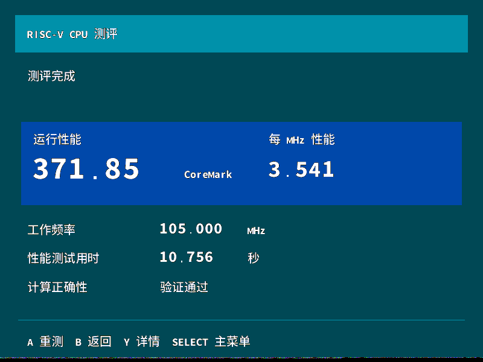

#### 3.2.2 图形实验

TILE 实验用于观察大量重复图块的绘制负载，DDR 位图实验用于观察外部素材读取与透明色处理，Alpha 实验用于观察混合操作。三者均提供软件与硬件绘制入口，使同一场景可沿两条路径执行。图 9、图 10 分别展示图块和混合实验的实际画面。

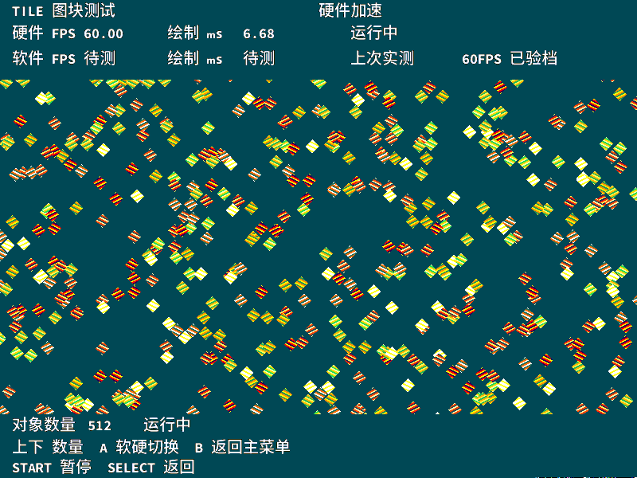

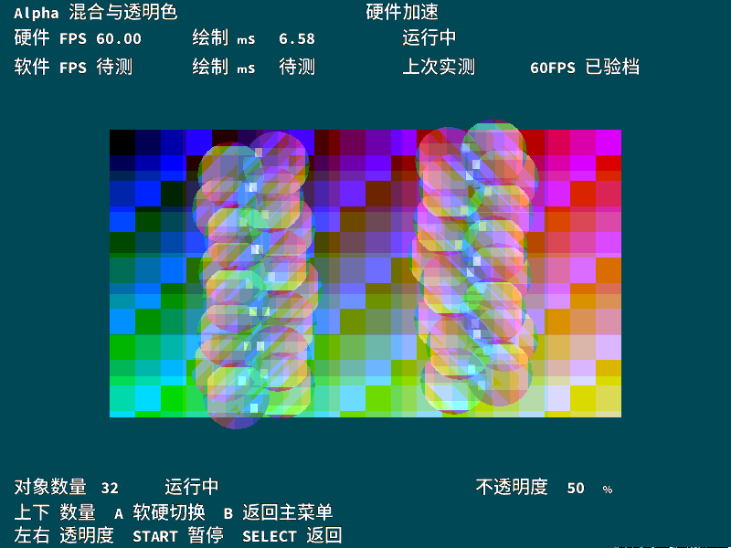

#### 3.2.3 交互应用

鸡蛋兄弟提供普通游戏与展示模式。普通模式保留角色操作和跟随镜头；展示模式固定总览视角，使用 LT、RT 在三个波次之间选择。选定波次后重复该波原有的 10 秒场景，不自动进入下一波，便于在视频或现场讲解中停留于同一负载。

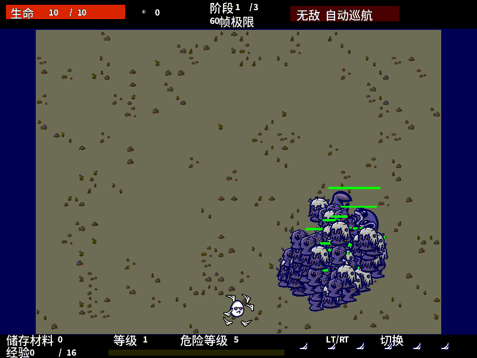

星际弹幕采用飞船与怪兽场景。中央区域保留战斗内容，左右区域分别显示操作说明和当前负载信息，右上角提示独立留出空间。LT、RT 对应三个弹幕密度等级，通过增加实际负载形成不同帧率，而非人为锁定显示刷新频率。图 12 为默认挡运行画面。

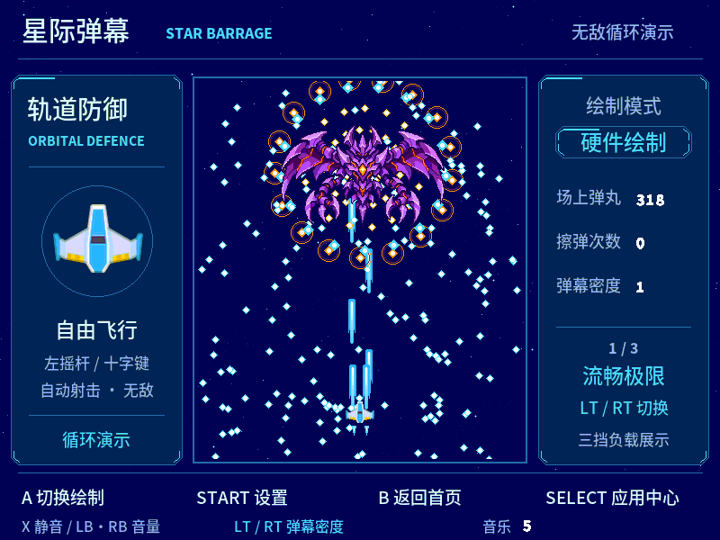

交互应用以角色运动、密集对象及背景层作为综合图形负载。战机素材采用 Kenney CC0 资源，怪兽图像经生成和 RGB332 编码后进入精灵接口；第三方规则、字体与音乐来源在工程来源清单中说明。

#### 3.2.4 系统实物与外设连接

图 13 展示当前演示装置。开发板、显示屏、集线器、手柄、鼠标及扬声器共同组成完整交互系统，屏幕显示云海单排主菜单。输入操作以手柄为主，触屏和鼠标提供补充入口。

开发板的 USB HOST 接口通过集线器连接外设，供电和上行连接保留实际测试时的接法。图 14 为接口与线缆局部，原始供电全景另随实拍材料保存。

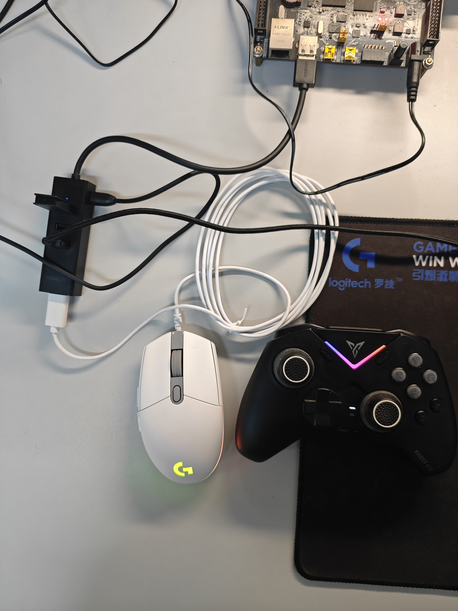

图 15 为转接板正面及音频模块，能够辨认双排母、洞洞板和 MAX98357A 丝印。图 16 给出安装后的音频链路与转接板焊接侧。商购功放模块和自行制作的接口转接板分别说明，系统音频数字链路的正确性仍以独立采样与 CRC 记录核对。

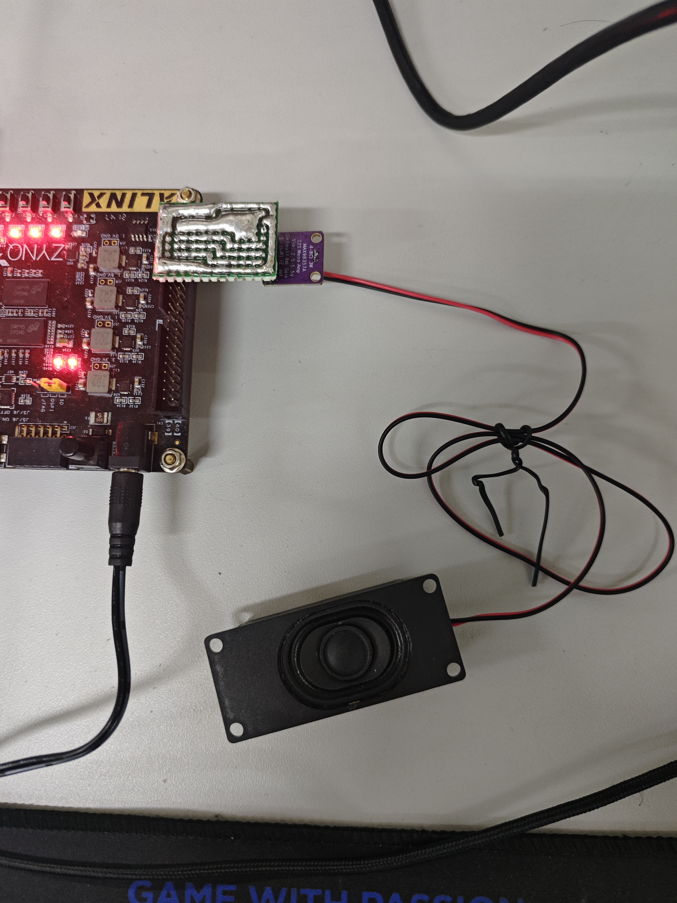

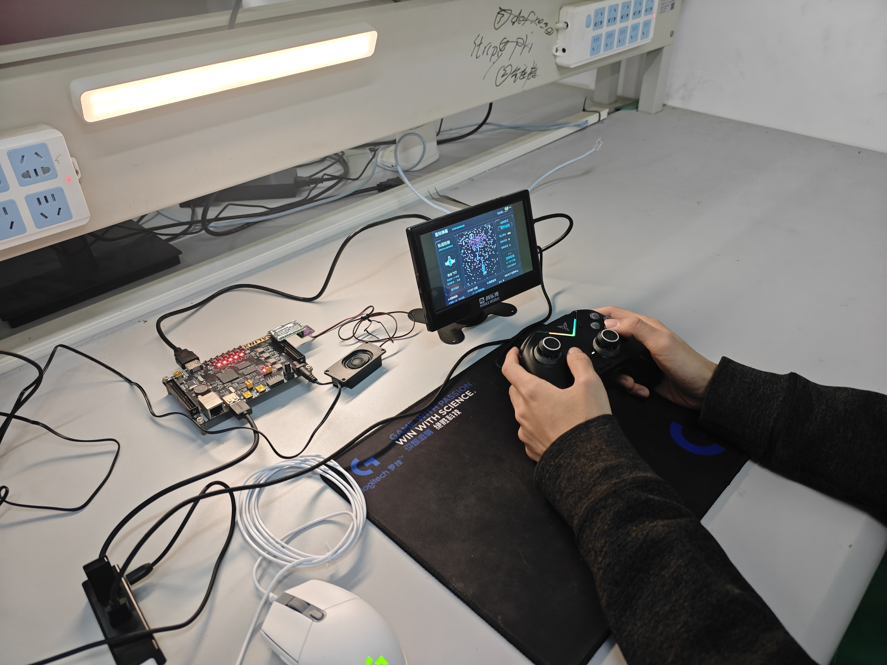

### 3.3 特性成果与性能分析

在相同对象数量与画面设置下，图形测试可直接切换软件绘制和硬件加速。现场录像结果栏给出了如下对照，直观体现专用像素处理对系统吞吐的提升；持续帧率另由后表的长窗口统计确认。

| 测试与对象数 | 软件 FPS | 硬件 FPS | 帧率比值 |
| --- | --- | --- | --- |
| TILE 512 | 7.49 | 59.99 | 8.01 倍 |
| DDR 位图 96 | 1.88 | 60.00 | 31.91 倍 |
| Alpha 32，50%混合 | 3.33 | 60.00 | 18.02 倍 |

我们将“扫描端保持刷新”和“应用持续生成新画面”分开计量。严格 60 FPS 测试要求连续不少于 60 秒，并核对新帧数与扫描数相同，同时检查非单位帧间隔、漏扫描及漏逻辑更新。这样可避免只观察 HDMI 刷新正常，就把重复显示的旧画面当作新的渲染结果。

| 场景 | 测量时长 | 完成新帧 | 对应扫描 | 结果 |
| --- | --- | --- | --- | --- |
| TILE 512 对象 | 60.4500 秒 | 3627 | 3627 | 严格 60 FPS |
| DDR 位图 96 对象 | 60.4167 秒 | 3625 | 3625 | 严格 60 FPS |
| Alpha 32 对象 | 60.4167 秒 | 3625 | 3625 | 严格 60 FPS |
| 星际默认挡 | 61.9333 秒 | 3716 | 3716 | 严格 60 FPS |

星际三挡对应密度参数 1、2、9，各挡连续测试不少于 60 秒，完成帧率为 60.00、51.98、31.84 FPS。默认挡实现逐扫描新帧输出，高负载挡呈现对象密度与绘制吞吐的定量关系，构成覆盖流畅交互到密集弹幕的梯度演示。

鸡蛋三个波次对应 64、85、100 个对象，各波保持至少 35 秒，内部重复 10 秒场景。每个计量段排除前 2 秒预热，多个约 8 秒有效段的平均帧率分别约为 60.00、41.83、29.75 FPS，结果见图 18。该统计方式反映可重复短场景的负载变化，与星际连续 60 秒窗口不同。

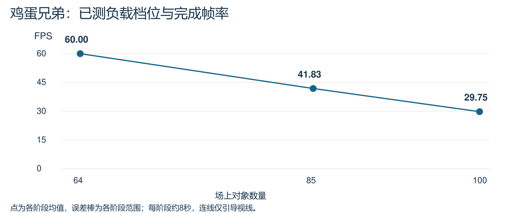

系统实现后占用 23447 LUT、11576 FF、126 BRAM36 和 4 DSP，LUT 使用比例约 44.07%。CPU 核心层级为 6387 LUT，包含 5998 个逻辑 LUT 与 389 个 LUTRAM；外部缓存、工作 RAM、图形和显示模块单列。CPU 资源效率按核心占用计算：371.852064 ÷ 6387 = 0.05822 CoreMark/LUT。105 MHz 实现的建立、保持及脉宽裕量分别为 +0.033 ns、+0.057 ns 和 +0.312 ns，满足完整实现时序要求。

| 统计范围 | LUT | FF | BRAM36 | DSP |
| --- | --- | --- | --- | --- |
| 完整 PL 系统 | 23447 | 11576 | 126 | 4 |
| CPU 核心层级 | 6387 | 2081 | 0 | 4 |

### 3.4 多模态交互与统一输入

手柄、触屏和鼠标经统一事件采集和状态映射接入应用。手柄提供按键、摇杆和扳机操作；触屏通过位置与时间联合判定双击，鼠标通过按键边沿完成进入与返回。输入状态随页面切换统一更新，使三种操作方式共享一致的交互逻辑。

实物演示完整覆盖手柄、触屏和鼠标的应用进入与返回，并展示手柄启动后的输入接续。多外设调度与统一输入接口共同支撑了主菜单、性能实验及交互应用的连续操作，提升系统展示的完整性与操作便利性。

### 3.5 运行管理与启动性能

为减少启动阶段的集中加载开销，管理程序合并大文件重复校验，并采用先进入菜单、首次选择应用时再加载相应资源的方式。应用加载后保留缓存，后续切换复用已准备的数据。启动参数在内存分配、复制和校验完成且软核仍暂停时发布，避免首次冷分配期间输入快照失效。

| 项目 | 当前观测结果 | 测量条件 |
| --- | --- | --- |
| 菜单出现 | 33.38 秒、36.10 秒 | 两轮软件重启和输入回放；此前约 40～43 秒 |
| 鸡蛋首次进入 | 2.82～4.58 秒 | 首次按需加载 |
| 星际首次进入 | 2.72～4.19 秒 | 首次按需加载 |
| 应用重复进入 | 约 0.38～0.60 秒 | 已加载资源继续缓存 |

按需加载和资源缓存共同优化了启动与切换体验：软件重启条件下，菜单出现时间由此前约 40～43 秒缩短至 33.38～36.10 秒，已加载应用重复进入约需 0.38～0.60 秒。测试条件与首次加载结果在表中分别列明。

音频补给由常驻管理进程统一调度，连续 FIFO 写入采用 C 函数批量执行，减少解释器逐样本处理开销。应用切换、图像 CRC 和 PCM 核对共同验证了按需加载与批量写入的功能一致性。

## 第四部分 总结

### 4.1 可扩展之处

系统以可加载 C 应用、统一图形命令和标准外设接口构成可扩展平台，可进一步承载仪表显示、交互教学、图形算法验证等二维应用。分带绘制、DDR 双缓冲及统一运行管理为新增应用提供了现成的执行和显示通路。

后续可围绕缓存策略、DDR 调度及像素处理并行度持续优化，并扩展显示格式与外设种类，使本作品形成兼具计算实验、图形验证和实物交互能力的开放式教学与开发平台。

### 4.2 心得体会

本作品的研制贯通了处理器微架构、图形数据通路、存储组织、嵌入式软件与实物连接。通过将复杂系统分解为明确的接口和完成条件，我们实现了从 C 程序执行到画面、声音及操作反馈的完整闭环，体会到软硬件协同设计对系统性能和工程完整性的共同作用。

性能优化围绕执行效率、合格频率和资源利用率展开。处理器采用预测与旁路提升有效执行，图形模块以专用硬件承担重复像素运算，分带方案以时序复用提高存储利用率。原始周期、独立像素参考与逐扫描新帧统计，使各项设计改进都能够通过可重复的测量进行评价。

开发过程中，大模型辅助源码分析、方案整理和测试脚本编写，参赛者完成设计取舍、接线与现场操作。我们将自动验证与实物演示结合，形成从方案、实现、测试到材料整理的系统化工作方式，并将产物校验和资源交接方法提炼为可复用技能包。

## 第五部分 参考文献

[1] AMD. 全国大学生嵌入式芯片与系统设计竞赛 FPGA 赛道 AMD 企业赛道指南 2026. https://gitee.com/Vickyiii/fpgachina26-amd/blob/master/TRACK_GUIDE_2026.md.

[2] EEMBC. CoreMark. https://github.com/eembc/coremark. 本项目固定版本及许可见仓库来源清单。

[3] Xilinx. PYNQ Python Productivity for Zynq. https://github.com/Xilinx/PYNQ.

[4] Digilent. Vivado Library RGB to DVI IP. https://github.com/Digilent/vivado-library.

[5] YosysHQ. PicoRV32. https://github.com/YosysHQ/picorv32.

[6] Project F. FPGA Graphics and Display Designs. https://github.com/projf/projf-explore.

[7] strigeus. fpganes. https://github.com/strigeus/fpganes. APU 来源与 GPL 条款见 licenses 目录。

[8] Kenney. Space Shooter Remastered. https://kenney.nl/assets/space-shooter-remastered.

[9] Taisei Project. Taisei. https://github.com/taisei-project/taisei. 实际复用范围及代码许可分别登记。

[10] 本项目工程资料. 源代码、构建配方与板端验证记录，2026.
