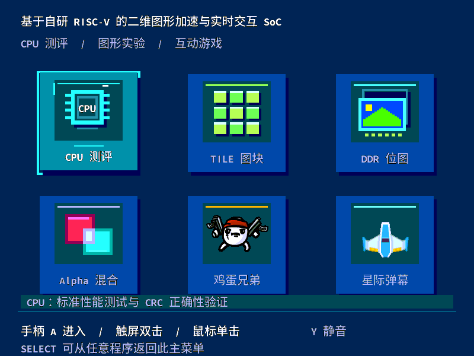

# 基于自研 RISC-V 的二维图形加速与实时交互 SoC

## 摘要

本项目设计并实现了一种面向二维图形处理与实时交互的可编程片上系统。系统以 AX7020 开发板的 Zynq XC7Z020 为载体，由自研 RISC-V 软核、专用二维图形模块、DDR 存储与显示通路，以及 PS 端管理程序共同组成。软核负责执行 C 应用中的状态更新、控制判断和绘图调度，图形模块完成矩形填充、图块、位图及 Alpha 混合，PS 端负责程序加载、USB 输入、音频数据补给和运行资源管理。

针对片上存储难以容纳完整高分辨率画布的问题，系统采用上下两带绘制方案，将一个 262144 字节暂存区复用于 800×600 RGB332 画面的生成。两带依次搬运至 DDR 后台帧缓冲区，待完整一帧准备完成后再切换显示，从而在有限 BRAM 容量下实现原生分辨率输出。为观察软硬件协同效果，系统集成 CPU 测评、三类图形实验与两款交互应用，并在统一菜单中提供手柄、触屏和鼠标操作。

测试结果表明，软核在 105 MHz 下的 CoreMark 性能配置得分为 371.852，两个测试配置的 CRC 均通过核对；TILE、DDR 位图和 Alpha 默认负载具有连续不少于 60 秒的逐扫描新帧记录。星际弹幕三挡负载实测约为 60.00、51.98 和 31.84 FPS。完整 PL 系统使用 23447 LUT、11576 FF、126 BRAM36 和 4 DSP。作品已形成可公开重建的 RTL、八个 RV32 程序、PS 运行程序和验证材料；USB 重新接入后的偶发失效仍列为待解决问题。

关键词：RISC-V；图形加速；分带帧缓冲；软硬件协同

## 第一部分 作品概述

### 1.1 功能与特性

本系统将处理器执行、图形绘制和实际交互整合在同一块 FPGA 开发板上。用户通过主菜单选择 CPU 测评、TILE 图块、DDR 位图、Alpha 混合、鸡蛋兄弟或星际弹幕。各应用由软核运行独立 C 程序，绘图命令经统一接口送入图形硬件；返回菜单时由 PS 管理程序完成应用退出和下一程序装载。系统不依赖 PC 实时计算游戏画面。

交互方式以手柄为主，同时提供触屏和鼠标入口。触屏单击卡片选中、双击进入，鼠标左键直接进入，第一层应用可通过鼠标右键或底部 SELECT 提示区返回。两款应用的展示模式使用 LT、RT 选择三个负载等级，便于演示流畅运行、开始掉帧和约 30 FPS 时的区别。默认音乐音量为 5；星际战斗配乐从原音轨第 5 秒开始播放。

### 1.2 应用领域

本系统主要面向 FPGA 软硬件协同教学、处理器实验和二维图形数据通路验证。通过同一场景下的软件绘制与硬件绘制，能够观察通用指令执行和专用像素处理的分工；通过独立程序加载及菜单切换，能够进一步理解程序存储、输入接口、音频和显示之间的配合关系。

对于处理器与图形模块的调试，单一基准程序难以覆盖实际系统中的连续运行情况。本作品将标准计算负载、固定图形负载和交互应用结合起来，使算术正确性、像素正确性与持续帧率可以分别验证。后续可在保持接口不变的条件下增加新的 C 应用，用于探索不同计算与绘制比例下的性能变化。

### 1.3 主要技术特点

处理器采用注册取指、译码队列、执行、访存和写回五个主流水级，并结合分支预测、结果旁路及受约束的相邻双指令执行路径，减少部分指令间等待。DDR 中的代码与只读素材通过 64 KiB 四路缓存和 4 KiB 指令缓冲访问，工作数据及栈放在独立的 128 KiB BRAM 中。

图形部分以矩形、TILE 和 DDR 位图为基础，支持裁剪、翻转、透明色及五档 Alpha 混合。显示画布为原生 800×600，并非将较低分辨率图像整体放大。上下两带共用一个暂存区，通过完整帧提交控制与 DDR 显示双缓冲配合，保证扫描端只接收准备完成的画面。

PS 端使用常驻管理进程统一组织输入、音频与应用切换。应用退出时先等待程序完成退出确认与数据搬运，再释放对应内存。测试中既保存性能数字，也保存程序身份、图像、CRC 和退出记录，使测量结果能够追溯到实际运行版本。

### 1.4 主要性能指标

| 指标 | 实测或配置结果 | 说明 |
| --- | --- | --- |
| 主器件 | XC7Z020CLG400-2 | AX7020 开发板 |
| CPU 时钟 | 105 MHz | 视频串行时钟为 525 MHz |
| CoreMark | 371.852 分，3.541 分/MHz | 4000 次迭代，105 MHz |
| 应用画布 | 800×600，RGB332 | 居中于 1024×600 HDMI 输出 |
| 图形默认负载 | TILE 512，位图 96，Alpha 32 | 连续至少 60 秒逐扫描验证 |
| 星际三挡 | 60.00／51.98／31.84 FPS | 每挡连续至少 60 秒 |
| 鸡蛋三波 | 60.00／41.83／29.75 FPS | 各波多个约 8 秒计量段 |
| 完整 PL 资源 | 23447 LUT，11576 FF | 126 BRAM36，4 DSP |

### 1.5 主要创新点

第一，围绕可加载 C 程序建立处理器、存储、图形与运行程序之间的统一接口，使系统既能运行标准测试，也能承载持续交互负载。创新重点在于自研执行和图形数据通路及其系统协同，游戏题材、基准算法和第三方素材分别保留原来源。

第二，通过两带绘制与完整帧提交，在 262144 字节暂存空间中生成 480000 字节的原生画面。该设计将片上存储容量约束转化为绘制与搬运的顺序协调，并通过提交状态控制避免显示半帧更新结果。

第三，将可重复验证纳入设计过程。软件与硬件绘制使用同一场景，像素结果与独立参考比较；帧率采用完成新帧与扫描计数共同判定；应用切换则核对当前程序的退出记录及总线排空状态，使性能与正确性能够同时被检验。

### 1.6 设计流程

本系统采用自顶向下的模块化设计方法。首先确定应用画布、处理器与图形分工、内存布局和输入方式，形成系统框图与接口定义。随后完成 RTL 模块设计，通过编译、功能仿真和时序分析逐步验证处理器、图形命令及显示提交逻辑。

在软件开发阶段，分别实现 CPU 测试、固定图形场景、菜单与交互应用，并建立独立像素参考及事件回放。系统联调阶段以单一运行管理进程串行加载测试，核对实际帧缓冲、音频 CRC、应用切换和故障恢复。最后冻结各程序的构建配方，从独立目录重建并整理技术文档。

## 第二部分 系统组成及功能说明

### 2.1 整体介绍

系统由 PS 管理端、PL 软核计算端、二维图形模块、DDR 存储与 HDMI 显示模块组成。图 1 给出主要数据流：PS 将程序和素材准备到连续物理内存，PL 软核读取并执行程序，图形模块根据绘图命令生成暂存带，搬运模块将其复制到 DDR 后台帧缓冲区，显示端读取已经提交的完整前台帧。

在该分工中，Linux/PYNQ 运行在 Zynq 的 PS ARM 上，自研 RISC-V 运行裸机 C 应用。PS 不替代软核执行游戏逻辑，也不在 PC 上生成画面。声音由 PS 持续补给 PCM 数据，PL 音频模块负责播放和串行输出；输入设备则由 PS 读取后转换为统一控制信息送入应用。

### 2.2 硬件系统介绍

#### 2.2.1 开发板与接口

硬件采用 AX7020 开发板及现有显示、USB 和音频外设。HDMI 输出的扫描尺寸为 1024×600，800×600 应用内容在水平方向居中，左右各保留 112 像素区域。CPU 与图形工作于 105 MHz，视频串行时钟为 525 MHz；两者承担不同功能，不能将视频时钟作为处理器性能指标。

本项目使用现成开发板和外设，主要设计内容集中于 PL 逻辑与系统软件，没有另行设计模拟采集板或机械机构。系统正面、斜 45 度整体以及 USB 和供电接线照片仍需在现场补充，技术框图和板端截图用于说明内部结构与功能。

#### 2.2.2 处理器结构

软核采用五个主流水级，使不同指令可在取指、译码、执行、访存及写回阶段同时推进。取指端设置译码队列，在共享存储服务存在等待时保留必要的请求空间；执行端结合旁路与预测信息，降低部分数据依赖和控制转移造成的停顿。处理器主要结构如图 2 所示。

双指令路径仅针对满足对齐、独立性和操作类型条件的相邻指令。第二槽限制为符合条件的 ALU 操作，两项结果仍按较老指令的顺序处理提交与异常，因此不等同于任意指令双发射或乱序执行。指令集包含 RV32I 和 Zmmul 乘法，未将乘法单元描述为完整 M 扩展的硬件除法支持。

#### 2.2.3 存储组织

程序与只读素材链接到 0x80000000 对应的 16 MiB 窗口，通过 64 KiB 四路只读缓存访问外部 DDR，缓存行为 64 字节。4 KiB 指令缓冲用于改善取指局部性；128 KiB 工作 RAM 位于 0x20000000，保存应用可写数据与栈。该结构使工作数据不必与大体积素材完全共享同一访问路径。

缓存行只有在 AXI 传输成功结束后才发布为有效内容。错误返回、刷新及暂停期间需要阻止不完整缓存行进入执行路径；控制转移后，旧取指响应也必须先完成排空，才能安全复用后续请求状态。系统当前没有可写通用数据缓存或虚拟内存机制。

#### 2.2.4 二维图形与显示通路

CPU 通过内存映射寄存器提交绘图参数，专用模块完成矩形填充、图块绘制、DDR 位图搬运、透明色处理、裁剪和翻转。Alpha 混合提供 0%、25%、50%、75%、100% 五档。软件比较模式由 CPU 执行像素操作，同时保留接口要求的暂存区初始化，其开销计入测量。图 3 给出控制、绘制和显示之间的连接关系。

完整 800×600 RGB332 画面需要 480000 字节，超过本设计单个暂存区容量。我们将画面分为两个 800×300 的区域，每带占用 240000 字节。先绘制上带并搬运至 DDR 后台帧缓冲区，再复用暂存区绘制下带。仅当两带均完成且到达允许切换的帧边界时，控制模块才更新前台帧缓冲区。

图 4 中，上带完成不会提前切换前台帧；下带完成后，系统仍等待帧边界再发布新画面。该图来自控制模块功能仿真，复制忙信号由测试平台给定，用来验证先后关系，不能据图中间隔推算板端 DMA 搬运时间。显示端使用双行缓存缓冲 DDR 访问波动。

### 2.3 软件系统介绍

#### 2.3.1 软件整体组成

软件分为 PS 管理程序、RV32 应用和 PC 侧构建验证工具三部分。PS 管理程序使用 Python/PYNQ 完成硬件加载、连续内存管理、USB 输入与 PCM 补给；RV32 应用负责菜单、计算测试、图形实验和游戏状态更新；PC 工具负责编译、参考模型计算、自动测试与结果整理。

八个 RV32 程序包括菜单、CoreMark 性能配置、CPU 验证配置、三类图形程序及两款交互应用。各程序分别保存实际源文件依赖、编译选项和预期二进制哈希，避免公共字库或渲染代码变化后无法重建某个已经测试的版本。

#### 2.3.2 输入与界面控制

PS 端读取手柄按键、摇杆和扳机，同时接收鼠标与触屏事件，再转换为应用使用的统一输入格式。触屏双击需要同一卡片及时间、位置约束；拖动、多点、页面切换与设备失联会取消未完成手势，防止上一页面的动作延续到下一页面。输入处理流程如图 5 所示。

主菜单直接展示六个功能入口，取消原有触屏方向和确认虚拟按钮条。用户可在同一界面选择操作方式，应用内部继续以手柄为主要控制设备。旧单 TT 集线器下，鼠标与有线手柄的 USB 调度曾出现资源冲突，因此另设精确设备兼容服务；该部分的已验证范围和最新故障在第三部分单独说明。

#### 2.3.3 音频与应用切换

音乐以 32 kHz 单声道有符号 16 位 PCM 保存。PS 负责持续补给数据，PL 完成播放及串行音频输出，界面提示音按既有混音路径叠加。数字链路通过采样计数和 CRC 验证，模拟输出听感仍需现场确认。音乐及提示音分别保留来源记录。

应用切换时，管理程序先请求当前应用完成退出确认，等待完整画面、音频暂停确认及 DMA 排空，再暂停处理器并释放程序资源。若排空状态不明，则保留运行资源，避免提前释放仍可能被硬件访问的内存。该退出顺序如图 6 所示。

早期联调曾在一帧尚未完成时先暂停处理器，导致补完下一带所需的程序无法继续执行。修正后先完成当前生产者的退出与搬运，再进入资源释放阶段。短退出确认包用于日常切换，不将其当作完整性能数据；性能测试仍保留完整采样和校验记录。

## 第三部分 完成情况及性能参数

### 3.1 整体完成情况

目前已完成原生 800×600 图形系统、统一菜单、CPU 与图形测试、两款交互应用，以及代码打包和独立重建。当前持久版本为 native800_final_visual_a。GitHub 已公开源码、完整运行输入和验证材料，公开包中的八个程序重新编译后均与板上采用的二进制一致。

实物照片尚未补齐，本报告中的运行画面均为板端帧缓冲回读图像，不能代替开发板及接线照片。最终提交前还需补充整体正面、斜 45 度和 USB／供电接线三张照片，并完成现场声音、操作和长时间运行检查。

### 3.2 工程成果

#### 3.2.1 主菜单与 CPU 测评

系统主菜单如图 7 所示。六张卡片将计算性能、固定图形负载与交互演示分开，进入应用后可通过统一返回方式回到菜单。触屏与鼠标的进入、返回逻辑已完成两种输入各六个入口的自动事件回放，实际 USB 设备的稳定性仍独立检验。

CPU 测评提供性能和正确性结果。性能配置采用 4000 次迭代，累计 1129481426 个 105 MHz 时钟周期，对应 10.75696596 秒，计算结果为 371.852064 次每秒。另一配置用于核对正确性，两轮分别检查五项 CRC。图 8 显示板端结果页，精确成绩由原始周期数计算，控制台整数秒与整数分值仅是显示格式。

#### 3.2.2 图形实验

TILE 实验用于观察大量重复图块的绘制负载，DDR 位图实验用于观察外部素材读取与透明色处理，Alpha 实验用于观察混合操作。三者均提供软件与硬件绘制入口，使同一场景可沿两条路径执行。图 9、图 10 分别展示图块和混合实验的实际画面。

展示用插图在版面中隐藏测试专用底部诊断区，原始 PNG 和 RGB332 回读数据仍完整保留。诊断区将程序标识、帧号和测试参数编码为像素，用于自动核验，因而原始截图底边会呈现彩色短线；正常交互入口不启用该调试模式。

#### 3.2.3 交互应用

鸡蛋兄弟提供普通游戏与展示模式。普通模式保留角色操作和跟随镜头；展示模式固定总览视角，使用 LT、RT 在三个波次之间选择。选定波次后重复该波原有的 10 秒场景，不自动进入下一波，便于在视频或现场讲解中停留于同一负载。

星际弹幕采用飞船与怪兽场景。中央区域保留战斗内容，左右区域分别显示操作说明和当前负载信息，右上角提示独立留出空间。LT、RT 对应三个弹幕密度等级，通过增加实际负载形成不同帧率，而非人为锁定显示刷新频率。图 12 为默认挡运行画面。

当前战机使用 Kenney CC0 素材，新怪兽由图像生成工具制作，经过 RGB332 编码后进入现有精灵接口。原有游戏规则、字体和音乐分别注明来源，不将整体画面或全部游戏内容称为本项目独立原创。

### 3.3 特性成果与性能分析

我们将“扫描端保持刷新”和“应用持续生成新画面”分开计量。严格 60 FPS 测试要求连续不少于 60 秒，并核对新帧数与扫描数相同，同时检查非单位帧间隔、漏扫描及漏逻辑更新。这样可避免只观察 HDMI 刷新正常，就把重复显示的旧画面当作新的渲染结果。

| 场景 | 测量时长 | 完成新帧 | 对应扫描 | 结果 |
| --- | --- | --- | --- | --- |
| TILE 512 对象 | 60.4500 秒 | 3627 | 3627 | 严格 60 FPS |
| DDR 位图 96 对象 | 60.4167 秒 | 3625 | 3625 | 严格 60 FPS |
| Alpha 32 对象 | 60.4167 秒 | 3625 | 3625 | 严格 60 FPS |
| 星际默认挡 | 61.9333 秒 | 3716 | 3716 | 严格 60 FPS |

星际三挡对应密度参数 1、2、9，各挡连续测试不少于 60 秒，完成帧率约为 60.00、51.98、31.84 FPS。低挡能够逐扫描提供新帧，较高挡随着对象与像素处理量增加出现真实掉帧。这些数据用于说明负载边界，不将高挡结果解释为显示链路工作在更低刷新率。

鸡蛋三个波次对应 64、85、100 个对象，各波保持至少 35 秒，内部重复 10 秒场景。每个计量段排除前 2 秒预热，多个约 8 秒有效段的平均帧率分别约为 60.00、41.83、29.75 FPS，结果见图 13。该统计方式反映可重复短场景的负载变化，与星际连续 60 秒窗口不同。

资源与时序方面，完整系统和 CPU 核心按不同层级统计。CPU 核心占用不包含外部缓存、工作 RAM 和图形模块；完整 PL 的 BRAM 使用比例较高，是采用分带方案的重要约束。当前实现的建立时间裕量为 +0.033 ns，保持时间裕量为 +0.057 ns，脉宽裕量为 +0.312 ns。功耗尚未实测。

| 统计范围 | LUT | FF | BRAM36 | DSP |
| --- | --- | --- | --- | --- |
| 完整 PL 系统 | 23447 | 11576 | 126 | 4 |
| CPU 核心层级 | 6387 | 2081 | 0 | 4 |

### 3.4 输入兼容性与当前问题

鼠标和触屏的应用进入、返回逻辑已通过自动回放，不能据此替代真实设备共存验收。对旧 05e3:0608 单 TT 集线器、G102、有线手柄和 P008 触屏，兼容服务通过停用鼠标附加键盘接口，并在手柄重新枚举时暂时释放鼠标主接口，曾使普通及约 1 秒手柄重插恢复三个输入。

2026 年 11 月 3 日，用户再次报告三输入失效：一次在持续运行期间出现，断电重启后恢复；另一次在启动手柄、相当于重新接入后出现。第二次故障已保留日志，同一启动会话内服务仍运行，手柄数据过期，USB 中断计数在观察窗口内不增长，设备地址未改变。现有服务主要依据设备地址变化触发恢复，该观察表明仍有未覆盖情形，根因及修复效果需要后续实验确认。

### 3.5 模型协作与可复现成果

本项目在需求分析、RTL 与软件实现、实验设计及文档整理中使用模型辅助。用户负责目标、操作方式、现场接线与实物反馈，并根据实验结果决定采用或撤销方案。实际可见协作记录与事后总结分别保存，不以补写对话代替真实过程。

联调中的一个重要修正是应用退出依赖顺序：单纯延长等待时间不能解决已经暂停的生产者无法补完整帧的问题，必须先完成正常退出和搬运，再释放资源。另一个修正是性能口径：扫描刷新率不能代替应用帧率，短场景平均值也不能代替连续长窗口结果。这些经验被整理为可复用的产物校验与 PYNQ 资源生命周期说明。

公开仓库保留 RTL、约束、IP 配置、八个应用源代码、PS 程序、仿真输入、实现报告和实际采样记录。软件公开包已经独立重建，八个二进制与采用版本一致；硬件已有从源综合、布局布线和 bit/XSA/HWH 导出记录，新生成的 bit 未自动替换板上已验证文件。GitHub 的 Linux 检查另核对文件哈希、Python 语法及运行包清单。

## 第四部分 总结

### 4.1 可扩展之处

当前系统已经具备可加载程序、图形加速与统一交互的基本结构。后续可在现有指令和图形接口上增加文字、仪表或其他二维应用，并通过相同测试流程确定负载边界。更复杂场景可能需要重新平衡 BRAM 容量、DDR 带宽及绘制命令开销，不能直接沿用当前帧率结论。

输入稳定性是当前收尾重点。应继续针对手柄启动、休眠恢复和重新枚举分别验证触发条件，补全设备地址不变时的异常检测与恢复。对于实物展示，还需完成照片、音频听感、不同操作方式与长期运行验收，再决定是否采用保留鼠标的完整组合。

### 4.2 心得体会

本次设计使我们认识到，一个能够持续运行的系统，需要的不只是单个模块通过仿真。处理器、图形模块、显示搬运和 PS 管理程序之间必须明确谁负责产生数据、何时允许更新状态、何时可以释放资源。早期退出过程中出现的问题，正是接口先后关系没有充分落实到运行程序中的体现。

在性能优化过程中，我们逐渐将关注点从单一数字转向可重复的测试条件。同样的帧率数字，可能来自不同的画面、不同的计量窗口，甚至只是扫描端重复显示旧帧。保存原始周期数、画面与版本信息，并使用独立参考进行核对，使优化结果更容易解释，也便于在新功能加入后判断是否发生退步。

模型辅助提高了代码检查、方案试验和材料整理的效率，但现场设备行为仍需要实际操作和日志来判断。此次手柄启动后再次出现失效，也提醒我们区分一次恢复和长期稳定。后续将继续围绕明确的复现条件开展实验，在保留失败记录的基础上完善作品，使技术说明、运行版本与实际演示保持一致。

## 第五部分 参考文献

[1] AMD. 全国大学生嵌入式芯片与系统设计竞赛 FPGA 赛道 AMD 企业赛道指南 2026. https://gitee.com/Vickyiii/fpgachina26-amd/blob/master/TRACK_GUIDE_2026.md.

[2] EEMBC. CoreMark. https://github.com/eembc/coremark. 本项目固定版本及许可见仓库来源清单。

[3] Xilinx. PYNQ Python Productivity for Zynq. https://github.com/Xilinx/PYNQ.

[4] Digilent. Vivado Library RGB to DVI IP. https://github.com/Digilent/vivado-library.

[5] YosysHQ. PicoRV32. https://github.com/YosysHQ/picorv32.

[6] Project F. FPGA Graphics and Display Designs. https://github.com/projf/projf-explore.

[7] strigeus. fpganes. https://github.com/strigeus/fpganes. APU 来源与 GPL 条款见 licenses 目录。

[8] Kenney. Space Shooter Remastered. https://kenney.nl/assets/space-shooter-remastered.

[9] Taisei Project. Taisei. https://github.com/taisei-project/taisei. 实际复用范围及代码许可分别登记。

[10] 本项目公开仓库. https://github.com/szllsz/rvgame-native800. 源代码 构建配方与验证材料。
